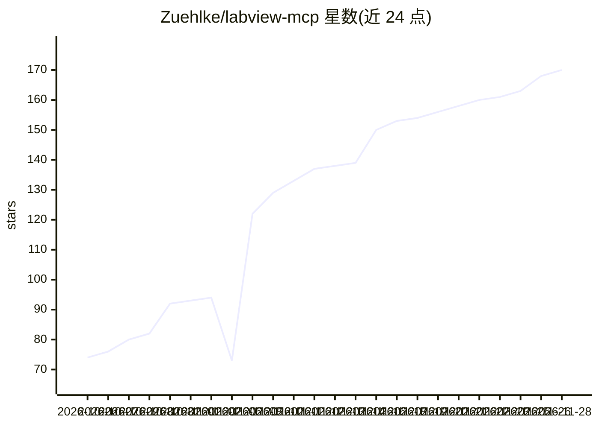

# Zuehlke/labview-mcp

⭐ 170 · Python · MIT · 推送 2026-11-27 · [GitHub](https://github.com/Zuehlke/labview-mcp) · 组织维护

**让 AI 助手读取、编写并运行本机 LabVIEW 代码的 MCP 服务器**

通过 MCP 协议把一台运行中的 LabVIEW（2020 及以上）暴露给 AI 客户端，使助手能以文本形式读取 VI 框图、生成并保存 .vi、原位编辑、顶层运行及执行构建规范。内置两套引擎：基于 NI gRPC/AIXML 的引擎需 LabVIEW 运行且需要许可；另一引擎用捆绑的 pylabview 在无 LabVIEW 环境下逐字节读写 .vi 容器。带 8 个 LabVIEW agent、读写分级确认（destructiveHint）与磁盘缓存。声明为研究阶段，未经生产验证，接口依赖 NI 私有 API，LabVIEW 升级可能失效。仅支持 Windows x64。

## 筛选速览

| 维度 | 判定 | 备注 |
|---|---|---|
| AI 角色 | `ai-ecosystem` | LLM/agent 周边工具 |
| 许可风险 | `permissive` | MIT |
| 部署形态 | `desktop` | 安装包/桌面程序 |
| 模型依赖 | — | README 未给出锁定关系 |
| 硬件要求 | — | 无带数字的原话,不猜 |
| 安装摩擦 | `low` | 无编译、无系统依赖或容器化 |
| 成熟度 | `idea` | |

## 能力要点

- VI 读取/生成/编辑/运行/构建五类 MCP 工具
- 双引擎：LabVIEW AIXML + 捆绑 pylabview 离线读写 .vi
- 写操作带 destructiveHint 强制确认，读操作可 allow-list
- 8 个内置 LabVIEW agent（生成器/编辑器/文档生成器等）

## 适用场景

- 让 AI 助手解释现有 VI 的功能并补写错误处理
- 从自然语言描述生成可运行的 .vi 文件
- 为 LabVIEW 库/类/项目批量生成 Word 文档
- 在无 LabVIEW 许可的机器上读取和编辑已有 VI

## 场景标签

`代码生成` `AI 写作` · 领域:编码与开发

## 证据(README 行号)

> L15: **An AI assistant that can read, write and run the LabVIEW code on your machine.**
> L63: LabVIEW MCP borrows the IDE's own hands. It drives a running LabVIEW, any version from 2020 (older not tested) on, 
> L64: MCP, so a VI becomes something an assistant can read as text and
> L118: ### Two engines, because one of them needs a licence

## 星数曲线

2026-10-26 74 → 2026-11-28 170（+96）

---
*卡片 v1 · prompt 1.4 · 生成 2026-11-28 · 置信度 high · 依据 README sha `6c7ea4fe0561` · [字段定义](../../DATASET.md)*
