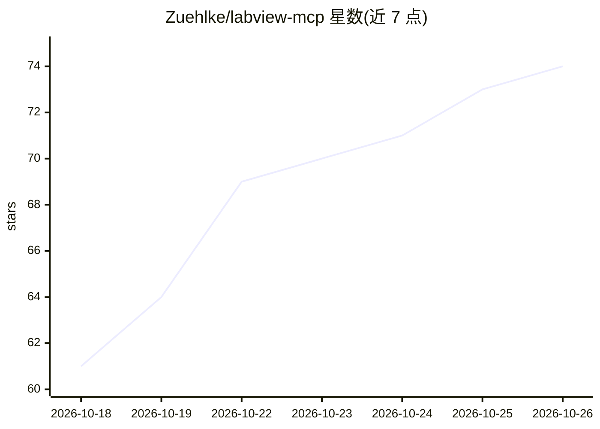

# Zuehlke/labview-mcp

⭐ 74 · Python · MIT · 推送 2026-10-25 · [GitHub](https://github.com/Zuehlke/labview-mcp) · 组织维护

**让 AI 助手读写运行本机 LabVIEW 代码的 MCP 服务器**

Zühlke 开源的 MCP 服务器，驱动运行中的 LabVIEW 2026，把 VI 转换为文本供 AI 助手读取、生成、编辑、运行与构建，并可检索已装选板与 NI 示例、生成 Word 文档。底层为四进程本地架构：基于 NI 开源 grpc-labview 的 AIXML 通道负责从零创建 VI，内置 pylabview 负责读取与编辑已有 VI。要求 Windows x64、LabVIEW 2026 Q3 与 Claude Code ≥ 2.1.224；自述为研究级，写工具会直接覆盖 .vi 文件，依赖 NI 未公开的私有接口，LabVIEW 升级可能使其失效。

## 筛选速览

| 维度 | 判定 | 备注 |
|---|---|---|
| AI 角色 | `ai-ecosystem` | LLM/agent 周边工具 |
| 许可风险 | `permissive` | MIT |
| 部署形态 | `desktop` | 安装包/桌面程序 |
| 模型依赖 | locked-api |  |
| 硬件要求 | — | 无带数字的原话,不猜 |
| 安装摩擦 | `low` | 无编译、无系统依赖或容器化 |
| 成熟度 | `idea` | |

## 能力要点

- AIXML（经 LabVIEW）与 pylabview 双引擎，按 VI 自动选择路径
- 读取/生成/编辑/运行/构建 VI，八个子代理与读写分级 allow-list
- 无需 LabVIEW 许可证的 pylabview 引擎可编辑读取 .vi 容器
- 以 Claude Code 插件方式安装，无需克隆或构建

## 适用场景

- 让 Claude Code 等 AI 客户端在 LabVIEW 项目中读写和运行 VI
- 把 .lvproj/.lvlib 的块图作为文本供助手理解
- 为库或项目自动生成含结构图的 Word 文档

## 场景标签

`编码 Agent` · 领域:编码与开发

## 证据(README 行号)

> L3: **An AI assistant that can read, write and run the LabVIEW code on your machine.**
> L51: LabVIEW MCP borrows the IDE's own hands. It drives a running LabVIEW 2026 and exposes it over
> L70: Four processes, all of them yours, none of them on the internet. The assistant talks to a small

## 星数曲线

2026-10-18 61 → 2026-10-26 74（+13）

---
*卡片 v1 · prompt 1.4 · 生成 2026-10-24 · 置信度 high · 依据 README sha `4a6dc40c6976` · [字段定义](../../DATASET.md)*
