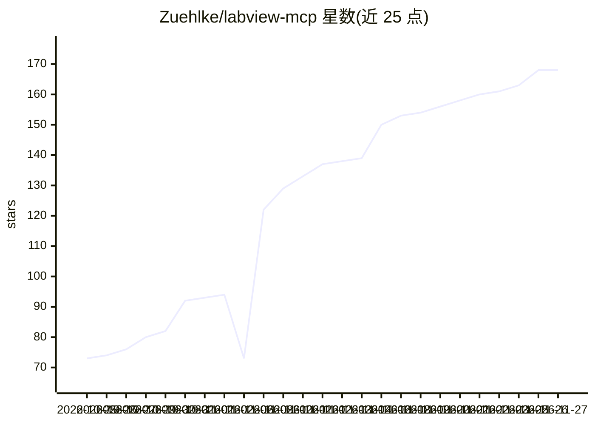

# Zuehlke/labview-mcp

⭐ 168 · Python · MIT · 推送 2026-11-26 · [GitHub](https://github.com/Zuehlke/labview-mcp) · 组织维护

**让 AI 客户端读写并运行本机 LabVIEW 代码的 MCP 服务器**

以 MCP 服务器形式将运行中的 LabVIEW 暴露给 AI 助手：读取 VI 的框图结构为文本、生成并保存新 VI、原地编辑现有框图、运行顶层 VI 并回读输出、执行构建规范、检索已安装面板与示例、由捆绑 agent 将库/类/项目生成 Word 文档。依赖 Windows x64 与 LabVIEW 2020 及以上；含 AIXML 与 pylabview 双引擎，写入类工具带破坏性确认提示，README 自述为研究阶段、未做生产验证。

## 筛选速览

| 维度 | 判定 | 备注 |
|---|---|---|
| AI 角色 | `ai-ecosystem` | LLM/agent 周边工具 |
| 许可风险 | `permissive` | MIT |
| 部署形态 | `desktop` | 安装包/桌面程序 |
| 模型依赖 | — | README 未给出锁定关系 |
| 硬件要求 | — | 无带数字的原话,不猜 |
| 安装摩擦 | `low` | 无编译、无系统依赖或容器化 |
| 成熟度 | `idea` | |

## 能力要点

- Read/Write/Edit/Run/Build 五类 MCP 工具，VI 以文本形式可读可生成
- 双引擎：AIXML 需运行 LabVIEW，pylabview 引擎无需 LabVIEW 与许可证
- 写操作携带 destructiveHint，每次执行前要求确认；读操作可 allow-list
- 捆绑 8 个 LabVIEW agent（VI 生成/编辑/文档生成/类生成/DQMH/单元测试框架）

## 适用场景

- 让 Claude Code 等 MCP 客户端解释已有 VI 的功能
- 用自然语言生成并保存新的 LabVIEW VI
- 对现有 VI 原地添加错误处理等修改
- 为库、类或项目自动生成含结构图的 Word 文档

## 场景标签

`代码生成` · 领域:编码与开发

## 证据(README 行号)

> L15: **An AI assistant that can read, write and run the LabVIEW code on your machine.**
> L63: LabVIEW MCP borrows the IDE's own hands. It drives a running LabVIEW, any version from 2020 (older not tested) on, 
> L64: MCP, so a VI becomes something an assistant can read as text and

## 星数曲线

2026-10-25 73 → 2026-11-27 168（+95）

---
*卡片 v1 · prompt 1.4 · 生成 2026-11-26 · 置信度 high · 依据 README sha `38b4b0e8cf5e` · [字段定义](../../DATASET.md)*
