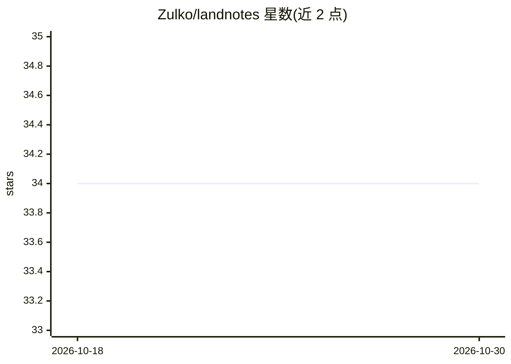

# Zulko/landnotes

⭐ 34 · Jupyter Notebook · MIT · 推送 2026-09-05 · [GitHub](https://github.com/Zulko/landnotes) · [官网](https://landnotes.org) · 个人维护

**地图应用：用 Gemini 从维基百科抽取 650 万事件叠加在 OpenStreetMap 上**

Landnotes 是一个 Web 应用，将从 40 万篇维基百科文章中用 Google Gemini 抽取的 650 万个地点与事件展示在 OpenStreetMap 地图上。技术栈：LeafletJS 渲染地图、Svelte 5 构建组件、Cloudflare（D1/R2/Workers）承载基础设施；数据侧用专门编写的 wiki-dump-extractor 处理维基百科 dump，mwparserfromhell 解析标记为纯文本。本地开发支持远程数据库模式（npm run dev:remote-dbs）和本地数据库模式（需自建数据库并运行 wrangler worker），作者提示抽取结果可能有错误且本地建库是难点。

## 筛选速览

| 维度 | 判定 | 备注 |
|---|---|---|
| AI 角色 | `ai-native` | 本体是模型或模型工具 |
| 许可风险 | `permissive` | MIT |
| 部署形态 | `None` |  |
| 模型依赖 | — | README 未给出锁定关系 |
| 硬件要求 | — | 无带数字的原话,不猜 |
| 安装摩擦 | `low` | 无编译、无系统依赖或容器化 |
| 成熟度 | — | 结构信号不足 |

## 能力要点

- 650 万事件来自 40 万篇维基百科文章的 Gemini 抽取
- 地图基于 OpenStreetMap，LeafletJS + Svelte 5 构建
- 支持远程数据库与本地数据库两种本地运行模式

## 适用场景

- 在地图上浏览维基百科记载的历史地点与事件
- 按地点与日期探索某区域相关的历史事件

## 场景标签

 · 领域:地理/知识可视化

## 证据(README 行号)

> L3: Landnotes shows Wikipedia places and events on top of OpenStreetMap - try it out!
> L5: There are currently 6.5 million events extracted from 400,000 articles using Google Gemini. If anything doesn't make

## 星数曲线

2026-10-18 34 → 2026-10-30 34（+0）

---
*卡片 v1 · prompt 1.4 · 生成 2026-10-25 · 置信度 high · 依据 README sha `8abdcc026e1a` · [字段定义](../../DATASET.md)*
