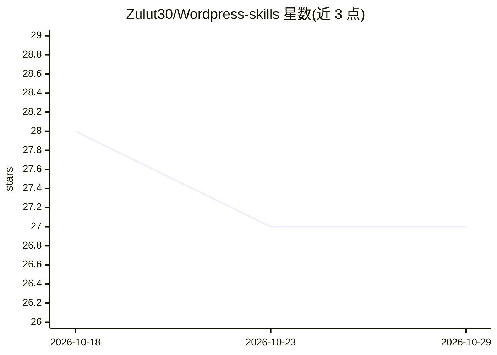

# Zulut30/Wordpress-skills

⭐ 27 · JavaScript · MIT · 推送 2026-06-07 · [GitHub](https://github.com/Zulut30/Wordpress-skills) · [官网](https://github.com/Zulut30/Wordpress-skills/blob/main/docs/demo.md) · 个人维护

**面向 AI 编程 agent 的 WordPress 插件开发技能包**

一个供 Codex、Claude Code、Cursor 等 Agent Skills 兼容工具使用的 WordPress 插件开发技能包：以 SKILL.md 为核心路由，附精选参考知识库、模板、测试夹具与启发式扫描脚本，覆盖插件脚手架、安全/性能/设计/兼容性审计与 WordPress.org 发布准备。通过 npm 安装与同步校验，扫描器为启发式而非安全预言机，README 自述为早期但经校验的项目。

## 筛选速览

| 维度 | 判定 | 备注 |
|---|---|---|
| AI 角色 | `ai-knowledge` | 知识聚合/清单类 |
| 许可风险 | `permissive` | MIT |
| 部署形态 | `library` | 以包/库形式分发 |
| 模型依赖 | — | README 未给出锁定关系 |
| 硬件要求 | — | 无带数字的原话,不猜 |
| 安装摩擦 | `low` | 无编译、无系统依赖或容器化 |
| 成熟度 | `idea` | |

## 能力要点

- SKILL.md 技能路由 + 精选 WordPress 参考知识库与模板
- 安全/性能/设计/兼容性四类审计扫描脚本（人工可读与 JSON 输出）
- Codex/Claude Code/Cursor 支持矩阵与对应安装流程
- GitHub Actions 运行 Node 校验、PHP 语法检查与夹具审计

## 适用场景

- 让 AI 编程 agent 按 WordPress 规范生成插件骨架
- 对现有插件做安全、性能与兼容性审计
- 发布前做 WordPress.org readiness 检查

## 场景标签

`代码生成` `代码审查` · 领域:编码与开发

## 证据(README 行号)

> L11: A professional Agent Skill for building, reviewing, testing, optimizing, designing, integrating, and releasing mode
> L92: skills/wordpress-plugin-dev/        canonical skill
> L94:   references/                       curated WordPress knowledge base

## 星数曲线

2026-10-18 28 → 2026-10-29 27（-1）

---
*卡片 v1 · prompt 1.4 · 生成 2026-10-26 · 置信度 high · 依据 README sha `5120f9203676` · [字段定义](../../DATASET.md)*
