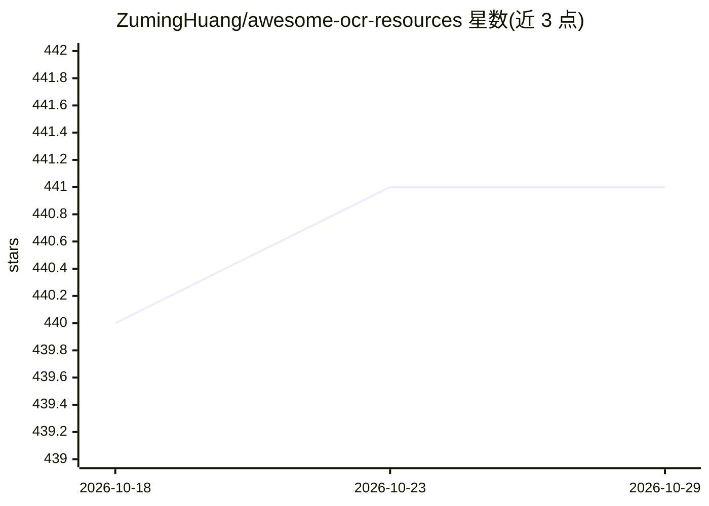

# ZumingHuang/awesome-ocr-resources

⭐ 441 · Python · MIT · 推送 2026-10-28 · [GitHub](https://github.com/ZumingHuang/awesome-ocr-resources) · 个人维护 · 中文 README

**OCR 与文档 AI 资源策展清单（论文/模型/数据集等）**

人工策展加自动化维护的 OCR 与 Document AI 资源聚合清单：收录 326 篇论文、829 个模型、438 个数据集、147 个代码库、284 个可安装 agent 技能及 1 个平台，共六类。维护机制上以 data/ 目录下 YAML 为数据源，Markdown 列表自动生成；每日自动发现候选并开 Draft PR 供人工审核，每周审计链接与元数据健康度。元数据按 CC0-1.0 公共领域发布，维护代码为 MIT。

## 筛选速览

| 维度 | 判定 | 备注 |
|---|---|---|
| AI 角色 | `ai-knowledge` | 知识聚合/清单类 |
| 许可风险 | `permissive` | MIT |
| 部署形态 | `None` |  |
| 模型依赖 | — | README 未给出锁定关系 |
| 硬件要求 | — | 无带数字的原话,不猜 |
| 安装摩擦 | `low` | 无编译、无系统依赖或容器化 |
| 成熟度 | — | 结构信号不足 |

## 能力要点

- 六类资源共 2,000 余条（论文 326、模型 829、数据集 438、代码 147、技能 284）
- 自动化发现+人工审核的策展流程，每日运行
- data/ 下 YAML 为数据源，Markdown 列表自动生成
- 每周链接与元数据健康度审计

## 适用场景

- 查找 OCR 与文档 AI 的论文、数据集和模型
- 为 agent 工作流寻找可安装的 OCR 技能
- 了解 OCR 领域可用代码库与平台服务

## 场景标签

`精选清单` · 领域:学习与行业

## 证据(README 行号)

> L5: A structured and human-curated collection of OCR and Document AI resources. Automation discovers and validates candi
> L13: |Papers|326|Research on OCR, document parsing, layout analysis, and document understanding|

## 星数曲线

2026-10-18 440 → 2026-10-29 441（+1）

---
*卡片 v1 · prompt 1.4 · 生成 2026-10-21 · 置信度 high · 依据 README sha `03e13ad6acc4` · [字段定义](../../DATASET.md)*
