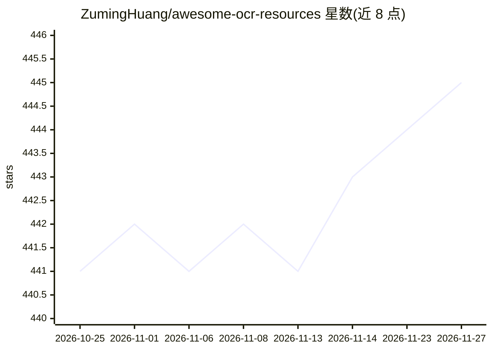

# ZumingHuang/awesome-ocr-resources

⭐ 445 · Python · MIT · 推送 2026-11-26 · [GitHub](https://github.com/ZumingHuang/awesome-ocr-resources) · 个人维护 · 中文 README

**OCR 与文档 AI 资源清单：论文/模型/数据集聚合**

一个经人工审核的 OCR 与 Document AI 资源集合，按论文（369）、模型（1284）、数据集（567）、代码库（224）、agent 技能（312）、平台等类别组织。维护机制上以 YAML 数据文件为唯一事实来源，Markdown 列表自动生成，发现流程每日运行并对候选资源开 Draft PR 供人工审核，链接与元数据每周健康审计。资源本身以 CC0-1.0 与 MIT 双重许可发布，第三方资源保留各自许可。

## 筛选速览

| 维度 | 判定 | 备注 |
|---|---|---|
| AI 角色 | `ai-knowledge` | 知识聚合/清单类 |
| 许可风险 | `permissive` | MIT |
| 部署形态 | `None` |  |
| 模型依赖 | — | README 未给出锁定关系 |
| 硬件要求 | — | 无带数字的原话,不猜 |
| 安装摩擦 | `low` | 无编译、无系统依赖或容器化 |
| 成熟度 | — | 结构信号不足 |

## 能力要点

- 收录论文 369、模型 1284、数据集 567、代码库 224、技能 312 条
- YAML 数据为事实来源，Markdown 列表自动生成
- 每日自动发现候选并以 Draft PR 形式人工审核
- 元数据每周健康审计

## 适用场景

- 查找 OCR 方向的论文与数据集
- 寻找可用的 OCR 模型权重与代码库
- 为文档工作流查找可安装的 agent 技能

## 场景标签

`OCR` `精选清单` · 领域:学习与行业

## 证据(README 行号)

> L5: A structured and human-curated collection of OCR and Document AI resources. Automation discovers and validates candi
> L13: |Papers|369|Research on OCR, document parsing, layout analysis, and document understanding|

## 星数曲线

2026-10-25 441 → 2026-11-27 445（+4）

---
*卡片 v1 · prompt 1.4 · 生成 2026-11-27 · 置信度 high · 依据 README sha `508b96029df2` · [字段定义](../../DATASET.md)*
