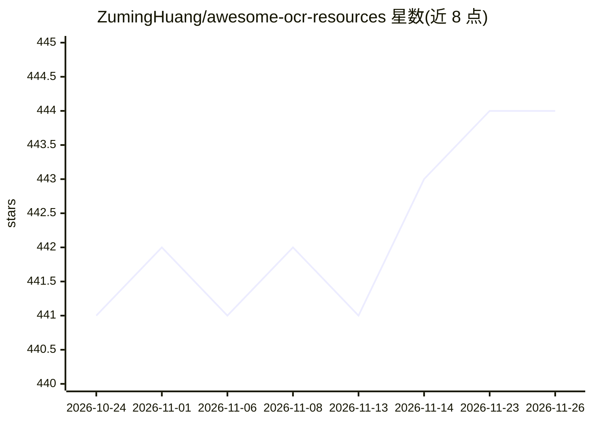

# ZumingHuang/awesome-ocr-resources

⭐ 444 · Python · MIT · 推送 2026-11-25 · [GitHub](https://github.com/ZumingHuang/awesome-ocr-resources) · 个人维护

**OCR 与文档 AI 资源清单：论文/模型/数据集/代码聚合**

人工维护的 OCR 与 Document AI 资源结构化清单，收录论文 364 篇、模型条目 1262 个、数据集 566 个、代码库 224 个、agent 技能 312 条。数据以 data/ 下 YAML 文件为源，Markdown 列表由自动化流程生成；自动化流程每日做候选发现并开 Draft PR 供人工审核，每周审计链接与元数据健康度。元数据与编辑内容采用 CC0-1.0 许可，维护代码采用 MIT 许可。

## 筛选速览

| 维度 | 判定 | 备注 |
|---|---|---|
| AI 角色 | `ai-knowledge` | 知识聚合/清单类 |
| 许可风险 | `permissive` | MIT |
| 部署形态 | `None` |  |
| 模型依赖 | — | README 未给出锁定关系 |
| 硬件要求 | — | 无带数字的原话,不猜 |
| 安装摩擦 | `low` | 无编译、无系统依赖或容器化 |
| 成熟度 | — | 结构信号不足 |

## 能力要点

- 按论文/模型/数据集/代码/技能等类别组织的资源计数清单
- YAML 为数据源，Markdown 列表自动生成
- 每日自动化发现候选并以 Draft PR 走人工审核
- 每周链接与元数据健康度审计

## 适用场景

- 查找 OCR 方向的论文与基准数据集
- 寻找公开可用的文字识别模型权重或代码库
- 为 OCR 文档工作流查找可安装的 agent 技能

## 场景标签

`精选清单` `OCR` · 领域:学习与行业

## 证据(README 行号)

> L5: A structured and human-curated collection of OCR and Document AI resources. Automation discovers and validates candi
> L13: |Papers|364|Research on OCR, document parsing, layout analysis, and document understanding|

## 星数曲线

2026-10-24 441 → 2026-11-26 444（+3）

---
*卡片 v1 · prompt 1.4 · 生成 2026-11-25 · 置信度 high · 依据 README sha `93341da8c477` · [字段定义](../../DATASET.md)*
