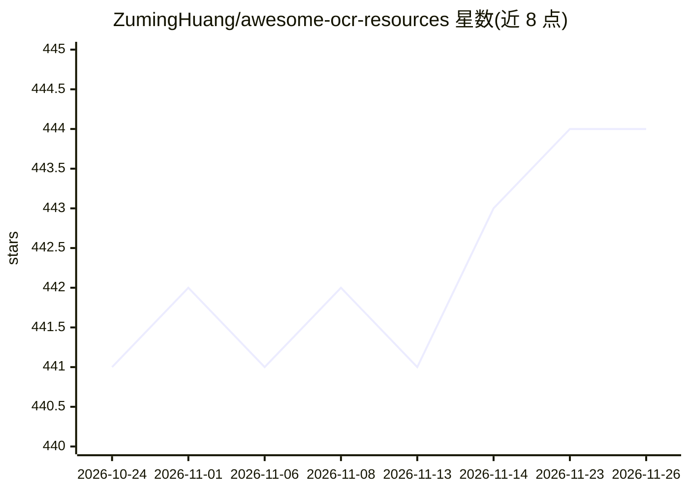

# ZumingHuang/awesome-ocr-resources

⭐ 444 · Python · MIT · 推送 2026-11-25 · [GitHub](https://github.com/ZumingHuang/awesome-ocr-resources) · 个人维护 · 中文 README

**OCR 与文档 AI 的论文/模型/数据集资源清单**

人工维护并辅以自动化发现的 OCR 与 Document AI 资源聚合清单，收录论文、公开模型、训练与评测数据集、代码库、可安装 agent 技能与平台等类别。YAML 数据文件为唯一事实来源，Markdown 列表自动生成；发现任务每日运行并开 Draft PR 供人工审核，链接与元数据每周审计。元数据内容采用 CC0-1.0 许可，维护代码采用 MIT 许可。

## 筛选速览

| 维度 | 判定 | 备注 |
|---|---|---|
| AI 角色 | `ai-knowledge` | 知识聚合/清单类 |
| 许可风险 | `permissive` | MIT |
| 部署形态 | `None` |  |
| 模型依赖 | — | README 未给出锁定关系 |
| 硬件要求 | — | 无带数字的原话,不猜 |
| 安装摩擦 | `low` | 无编译、无系统依赖或容器化 |
| 成熟度 | — | 结构信号不足 |

## 能力要点

- 收录论文 364 篇、模型 1262 个、数据集 567 个、代码库 224 个
- 每日自动化发现候选资源，人工审核后发布
- YAML 数据为源，Markdown 列表自动生成
- 元数据 CC0-1.0、维护代码 MIT 双重许可

## 适用场景

- 查找 OCR 与文档解析方向的论文和基准数据集
- 为文档工作流挑选可安装的 agent 技能
- 跟踪 OCR 领域公开模型发布

## 场景标签

`精选清单` `OCR` `文档解析` · 领域:知识与检索

## 证据(README 行号)

> L5: A structured and human-curated collection of OCR and Document AI resources. Automation discovers and validates candi
> L35: - YAML files under `data/` are the source of truth.

## 星数曲线

2026-10-24 441 → 2026-11-26 444（+3）

---
*卡片 v1 · prompt 1.4 · 生成 2026-11-26 · 置信度 high · 依据 README sha `368a665b6744` · [字段定义](../../DATASET.md)*
