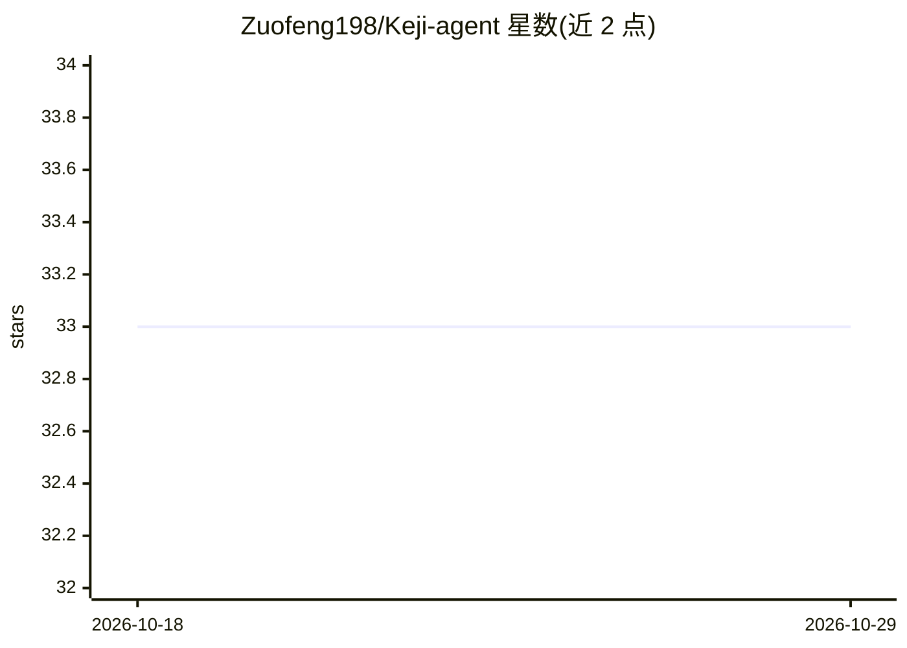

# Zuofeng198/Keji-agent

⭐ 33 · Python · NOASSERTION · 推送 2026-06-03 · [GitHub](https://github.com/Zuofeng198/Keji-agent) · [官网](https://github.com/Zuofeng198/keji#readme) · 个人维护 · 中文 README

**Windows 本地/局域网多用户 AI 助手：网页对话与团队文件工作区**

面向办公室内网一台服务器、多人网页访问场景的 AI 助手应用：Agent 引擎基于开源项目 nanobot（HKUDS，MIT），其上增加 Web 前端、三种角色权限（管理员/成员/只读）、团队共享与个人文件目录及管理员后台。支持流式对话，默认模型为 DeepSeek（config.yaml 可改），可选 Node.js 提供 MCP 工具，另有 Chroma 知识库检索。Windows 部署通过 bat 脚本完成：git clone + Git LFS 拉取约 400MB 离线依赖包，一键创建 venv 并安装。

## 筛选速览

| 维度 | 判定 | 备注 |
|---|---|---|
| AI 角色 | `ai-native` | 本体是模型或模型工具 |
| 许可风险 | `none` | NOASSERTION |
| 部署形态 | `desktop` | 安装包/桌面程序 |
| 模型依赖 | locked-api |  |
| 硬件要求 | — | 无带数字的原话,不猜 |
| 安装摩擦 | `low` | 无编译、无系统依赖或容器化 |
| 成熟度 | — | 结构信号不足 |

## 能力要点

- 基于 nanobot 引擎，浏览器流式对话，会话按用户保存
- 管理员/成员/只读三种角色权限体系
- 团队共享目录 + 个人独立目录的文件工作区
- 离线 wheel 依赖包（Git LFS）支持内网部署，可选 MCP 与 Chroma 知识库

## 适用场景

- 办公室内网部署一台服务器，多人通过浏览器使用 AI 对话
- 团队共享文件并按角色控制读写权限
- 离线/内网环境部署 AI 助手

## 场景标签

`AI 助手` `聊天机器人` `文档问答` · 领域:对话与助手

## 证据(README 行号)

> L3: Windows 上的**本地 / 局域网 AI 助手**：浏览器打开即可对话，支持多账号、团队共享文件夹、管理员后台。适合办公室内网一台服务器、多人通过网页访问。
> L17: - 网页里和 AI 对话（流式回复，会话按用户保存）

## 星数曲线

2026-10-18 33 → 2026-10-29 33（+0）

---
*卡片 v1 · prompt 1.4 · 生成 2026-10-25 · 置信度 high · 依据 README sha `657f19a58954` · [字段定义](../../DATASET.md)*
