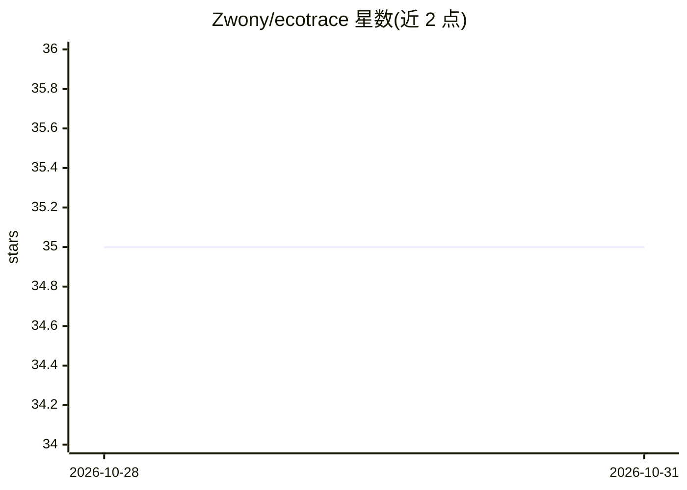

# Zwony/ecotrace

⭐ 35 · Python · MIT · 推送 2026-10-30 · [GitHub](https://github.com/Zwony/ecotrace) · [官网](https://ecotracelibrary.com) · 个人维护

**Python 应用与 AI/LLM 流水线的进程级能耗与碳排放测量库**

零配置的硬件级能耗剖析工具：通过 RAPL/NVML/Apple Silicon 采集进程级能耗（Joules/kWh）、运行时延迟与碳排放（gCO2），内置 209 国家/地区的电网碳强度数据，支持离线本地运行。提供函数装饰器、零改码 CLI、LangChain/HuggingFace 回调、CodeCarbon 兼容 API、A/B 实现对比与碳预算门禁，并配套 pytest 插件与 GitHub Action 在 CI 中执行碳排放门控。面向 Python 开发者与绿色计算研究者。

## 筛选速览

| 维度 | 判定 | 备注 |
|---|---|---|
| AI 角色 | `ai-ecosystem` | LLM/agent 周边工具 |
| 许可风险 | `permissive` | MIT |
| 部署形态 | `library` | 以包/库形式分发 |
| 模型依赖 | — | README 未给出锁定关系 |
| 硬件要求 | — | 无带数字的原话,不猜 |
| 安装摩擦 | `low` | 无编译、无系统依赖或容器化 |
| 成熟度 | — | 结构信号不足 |

## 能力要点

- 进程级隔离的能耗测量（RAPL/NVML/Apple Silicon），50ms 采样
- LangChain 原生回调，按 run_id 记录 LLM 调用的能耗、碳排放与 token 用量
- CodeCarbon API 签名兼容（EmissionsTracker/@track_emissions），可零重构迁移
- 内置碳预算门禁：CLI gate 与 pytest --ecotrace 在 CI 中阻止超标合并

## 适用场景

- 测量 LLM 调用或 RAG 流水线每次运行的能耗与碳排放
- 在 CI/CD 中设置碳排放预算门禁，拦截高碳回归
- 对比两种实现（如 Pandas vs Polars）的能效
- 记录 HuggingFace 训练过程的逐步排放

## 场景标签

`LLM 可观测性` · 领域:评测与运维

## 证据(README 行号)

> L8: **EcoTrace is a lightweight, zero-configuration hardware profiler for Python applications, AI training pipelines, an
> L36: - **Native LangChain Callback (`ecotrace.callbacks.langchain`)** — Thread-safe `EcoTraceLangChainCallback` for Lang

## 星数曲线

2026-10-28 35 → 2026-10-31 35（+0）

---
*卡片 v1 · prompt 1.4 · 生成 2026-10-28 · 置信度 high · 依据 README sha `c6eed6c1497a` · [字段定义](../../DATASET.md)*
