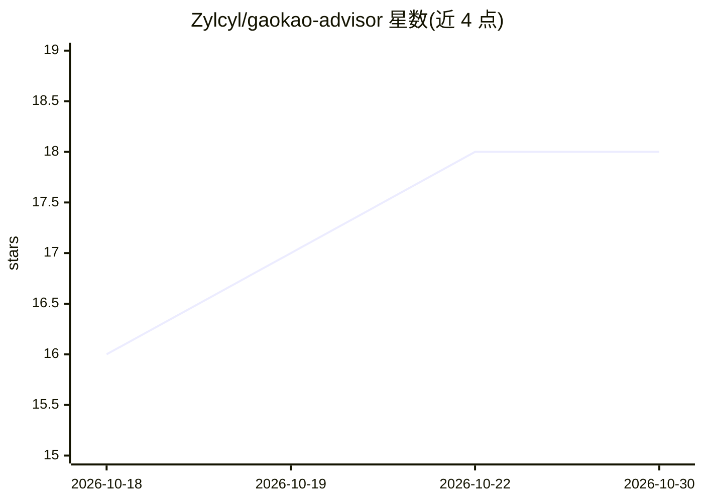

# Zylcyl/gaokao-advisor

⭐ 18 · MIT · 推送 2026-06-03 · [GitHub](https://github.com/Zylcyl/gaokao-advisor) · 个人维护 · 中文 README

**高考志愿填报 AI 顾问：多 Skill 协调的志愿决策辅助系统**

面向高考考生与家长的 AI 志愿填报技能包：以 SKILL.md 为主调度中心，协调分数线检索、ADI 四维评估、报告生成等模块，安装到 Claude Code、Cursor、Cowork 等支持 Skills 的 agent 后通过对话使用。机制上政策优先（先搜索当年最新政策）、位次为锚点、识别 12 种考生场景走不同路径；每年更新 config.json 年份即可复用。数据基于公开来源，概率估算为粗略参考，不编造录取信息。也可不安装、直接把 SKILL.md 粘贴进对话使用。

## 筛选速览

| 维度 | 判定 | 备注 |
|---|---|---|
| AI 角色 | `ai-ecosystem` | LLM/agent 周边工具 |
| 许可风险 | `permissive` | MIT |
| 部署形态 | `None` |  |
| 模型依赖 | — | README 未给出锁定关系 |
| 硬件要求 | — | 无带数字的原话,不猜 |
| 安装摩擦 | `low` | 无编译、无系统依赖或容器化 |
| 成熟度 | — | 结构信号不足 |

## 能力要点

- 多 Skill 协调架构：主调度 + 分数线检索 + ADI 评估 + 报告生成
- 自动识别 12 种考生场景并走不同交互路径
- 年度通用：每年仅更新 config.json 年份即可使用
- 覆盖出分前估分到填报后心理支持的全流程

## 适用场景

- 出分后让 AI 帮我检索数据、生成志愿填报方案
- 我是艺体生/复读生/低分段等特殊场景，需要针对性的填报建议
- 填报截止前的紧急场景下快速缩小志愿选择范围

## 场景标签

 · 领域:教育/升学咨询

## 证据(README 行号)

> L29: ├── SKILL.md                              主调度中心（323行）
> L47: 将整个 `gaokao-advisor` 文件夹复制到你的 AI agent 的 skills 目录：
> L51: |Claude Code|`~/.claude/skills/gaokao-advisor/`|

## 星数曲线

2026-10-18 16 → 2026-10-30 18（+2）

---
*卡片 v1 · prompt 1.4 · 生成 2026-10-29 · 置信度 mid · 依据 README sha `c333bd8d012a` · [字段定义](../../DATASET.md)*
