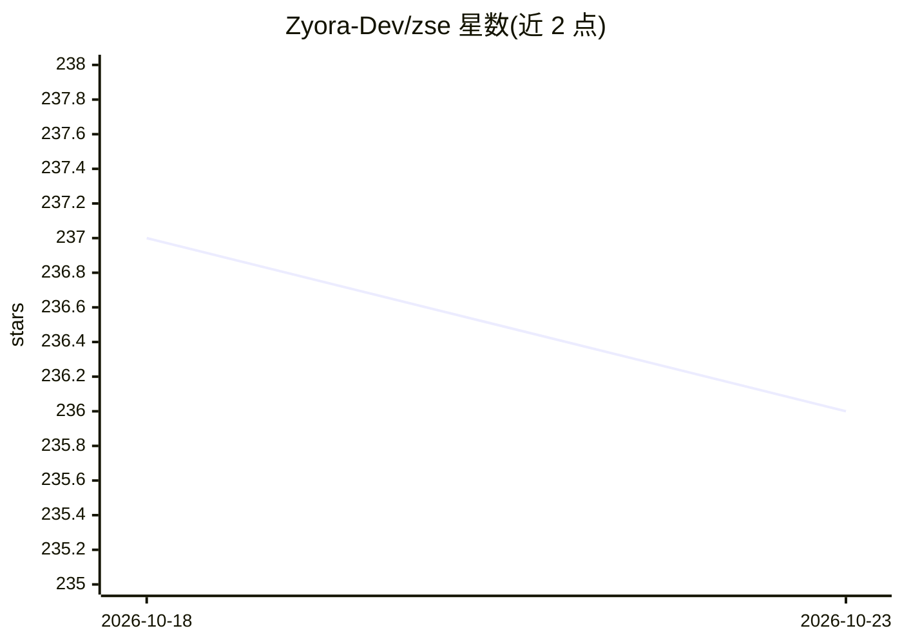

# Zyora-Dev/zse

⭐ 236 · Python · 推送 2026-09-27 · [GitHub](https://github.com/Zyora-Dev/zse) · [官网](https://zllm.in) · 组织维护

**零依赖 LLM 推理引擎：纯 Python 自研全栈，秒级冷启动**

以纯 Python + ctypes + 自研内核编译器实现的 LLM 推理引擎，不依赖 PyTorch/Triton/transformers；内核编译器将 Python 编写的 GPU 内核直接生成 CUDA/HIP/Metal 代码。提供 OpenAI 兼容 API、连续批处理、投机解码、张量并行、LoRA 热切换、内置 RAG（BM25+TF-IDF+稠密检索、重排、ZPF 压缩）与 SQLite 鉴权限流。模型采用 .zse 单文件格式（预量化、mmap），支持 Llama/Mistral/Qwen2/Gemma2/Phi3。README 自述局限：N≥4 并发吞吐未追平 vLLM、Apple Silicon 尚未跑通完整推理路径。面向需要在多样 GPU（NVIDIA/AMD/Apple）上部署 LLM 服务的开发者。

## 筛选速览

| 维度 | 判定 | 备注 |
|---|---|---|
| AI 角色 | `ai-ecosystem` | LLM/agent 周边工具 |
| 许可风险 | `none` | — |
| 部署形态 | `library` | 以包/库形式分发 |
| 模型依赖 | — | README 未给出锁定关系 |
| 硬件要求 | — | 无带数字的原话,不猜 |
| 安装摩擦 | `medium` | 含编译或系统依赖之一 |
| 成熟度 | — | 结构信号不足 |

## 能力要点

- 零第三方依赖，pip 安装体积约 5 MB，冷启动数秒
- 内核编译器从纯 Python 生成 CUDA/HIP/Metal 代码
- 支持 CUDA、ROCm、Metal 三种后端，覆盖 NVIDIA/AMD/Apple 硬件
- 内置 RAG、鉴权限流、Web 仪表盘与 LoRA 热切换

## 适用场景

- 在多厂商 GPU 环境部署 LLM 推理服务
- 内存受限的 GPU 上运行量化大模型
- 通过 OpenAI 兼容 API 提供带鉴权与限流的服务
- 在推理引擎内直接做文档检索问答（RAG）

## 场景标签

`推理引擎` `RAG` · 领域:知识与检索

## 证据(README 行号)

> L15: ZSE is a production LLM inference engine that owns the full stack — **no PyTorch, no Triton, no bitsandbytes, no tr
> L113: zse serve qwen-7b.zse --port 8000
> L134: - OpenAI-compatible API (`/v1/chat/completions`, `/v1/completions`, `/v1/models`)

## 星数曲线

2026-10-18 237 → 2026-10-23 236（-1）

---
*卡片 v1 · prompt 1.4 · 生成 2026-10-22 · 置信度 high · 依据 README sha `5b417a381e0d` · [字段定义](../../DATASET.md)*
