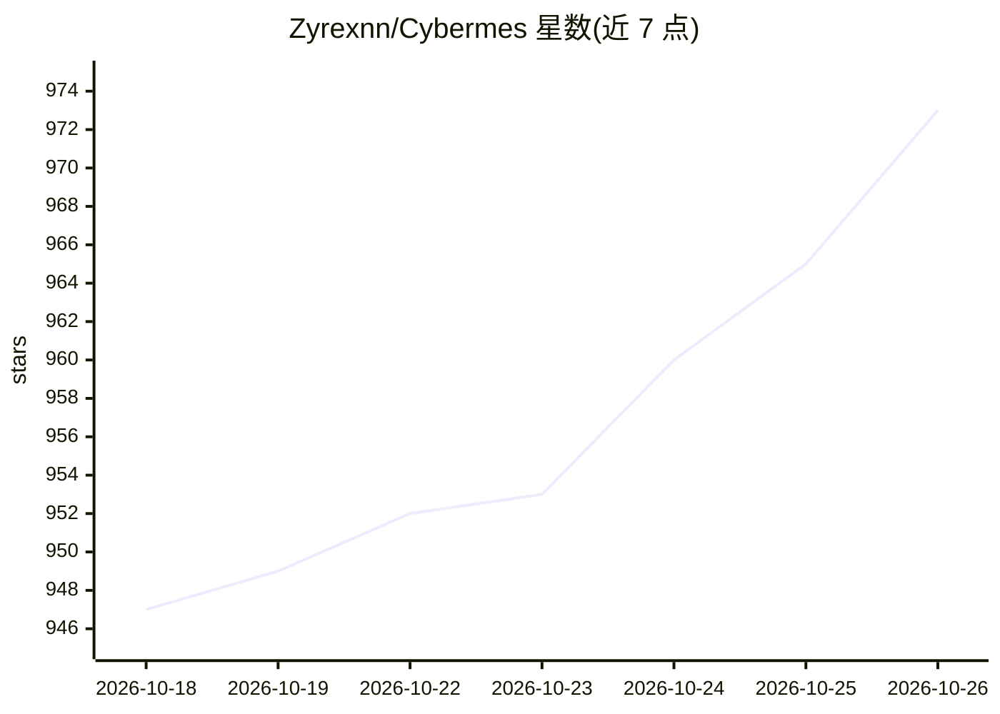

# Zyrexnn/Cybermes

⭐ 973 · Python · Apache-2.0 · 推送 2026-10-24 · [GitHub](https://github.com/Zyrexnn/Cybermes) · 个人维护

**授权攻防与漏洞赏金自动化框架，含 MCP 服务器与自主 CLI**

面向授权的漏洞赏金、侦察与漏洞研究的攻防安全助手与自动化框架，提供两条工作流：一是内置 Hermes 自主 Agent 的独立 CLI，可自主编排 subfinder/httpx/katana/ffuf 等侦察工具，经 Go 编写的 smart_pipe 过滤流式输出以控制 token，再以非破坏性 PoC 脚本验证假设并生成 Markdown/HTML/PDF 报告；二是原生 Go 实现的 MCP 服务器（cybermes-mcp），向 Claude Desktop、Cursor、Windsurf 等 AI 客户端以 JSON-RPC 2.0 暴露 10+ 安全工具与 200+ 攻防 playbook，并附 200+ 条 PayloadsAllTheThings/HackTricks 离线知识库。支持 Windows/Linux/macOS/Docker 安装，附带环境体检工具 doctor.py。

## 筛选速览

| 维度 | 判定 | 备注 |
|---|---|---|
| AI 角色 | `ai-ecosystem` | LLM/agent 周边工具 |
| 许可风险 | `permissive` | Apache-2.0 |
| 部署形态 | `desktop` | 安装包/桌面程序 |
| 模型依赖 | — | README 未给出锁定关系 |
| 硬件要求 | — | 无带数字的原话,不猜 |
| 安装摩擦 | `low` | 无编译、无系统依赖或容器化 |
| 成熟度 | — | 结构信号不足 |

## 能力要点

- 原生 Go MCP 服务器向 AI 客户端暴露 10+ 安全工具与上下文提供器
- 内置 Hermes 自主 Agent 的 CLI 工作流：侦察编排→smart_pipe 流过滤→PoC 验证→报告生成
- 200+ 攻防 playbook 离线知识库（含 PayloadsAllTheThings、HackTricks 数据集）
- subfinder/httpx/katana/ffuf/nuclei/sqlmap 集成侦察流水线

## 适用场景

- 授权漏洞赏金项目中自动化侦察与漏洞验证
- 在 Claude Desktop/Cursor 等 AI 编辑器中通过 MCP 调用安全扫描工具
- 红队/渗透测试交付物（SUMMARY.md/HTML/PDF 报告）的自动生成

## 场景标签

`网络安全` · 领域:学习与行业

## 证据(README 行号)

> L26: Cybermes can be used directly through your AI assistant via **Model Context Protocol (MCP)** or executed as a **sta
> L154: In the MCP workflow, **Cybermes operates as a native JSON-RPC 2.0 server (`cybermes-mcp`)** providing specialized 

## 星数曲线

2026-10-18 947 → 2026-10-26 973（+26）

---
*卡片 v1 · prompt 1.4 · 生成 2026-10-21 · 置信度 high · 依据 README sha `b260e87a12d0` · [字段定义](../../DATASET.md)*
