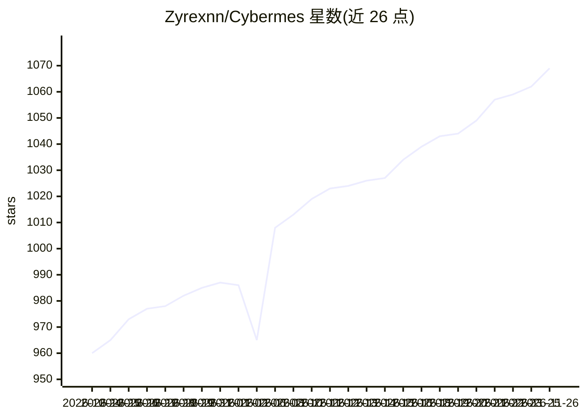

# Zyrexnn/Cybermes

⭐ 1,069 · Python · Apache-2.0 · 推送 2026-11-24 · [GitHub](https://github.com/Zyrexnn/Cybermes) · 个人维护

**面向授权渗透测试的 AI Agent 安全评估框架**

面向授权漏洞赏金与红队场景的自动化攻击性安全框架，提供两种运行模式：内置 Hermes Agent 的 CLI 自主执行（侦察、知识检索、PoC 验证、报告生成），以及通过 MCP 服务向外部 AI 客户端暴露 10+ Go 原生安全工具与 200+ 攻击 playbook。包含 smart_pipe 流过滤降低上下文占用、本地离线知识库查询、非破坏性 PoC 验证门槛，输出 Markdown/HTML/PDF 报告。安装支持 npm、源码脚本与 Docker，运行需 Go 1.22+ 与 Python 3.11+。

## 筛选速览

| 维度 | 判定 | 备注 |
|---|---|---|
| AI 角色 | `ai-native` | 本体是模型或模型工具 |
| 许可风险 | `permissive` | Apache-2.0 |
| 部署形态 | `desktop` | 安装包/桌面程序 |
| 模型依赖 | — | README 未给出锁定关系 |
| 硬件要求 | — | 无带数字的原话,不猜 |
| 安装摩擦 | `low` | 无编译、无系统依赖或容器化 |
| 成熟度 | — | 结构信号不足 |

## 能力要点

- Hermes Agent CLI 自主执行侦察、假设验证与报告编译
- MCP 服务（cybermes-mcp）向 13+ AI 客户端暴露安全工具
- smart_pipe 流过滤仅向 LLM 上下文推送高信号输出
- 200+ 离线 playbook 知识库亚 50ms 查询与 PoC 验证门槛

## 适用场景

- 对授权目标执行自动化侦察与漏洞验证
- 在 Cursor/Claude 等 AI 编辑器中调用安全工具链
- 批量生成含证据的结构化渗透测试报告
- Windows 环境下替代 Kali 工具链做安全评估

## 场景标签

`网络安全` · 领域:学习与行业

## 证据(README 行号)

> L19:  Cybermes is an offensive security assistant and automation framework designed for authorized bug bounty hunting, r
> L158: 1. **Autonomous Hermes CLI Workflow**: Fully autonomous terminal/headless execution where the local Hermes engine 
> L186: In the MCP workflow, **Cybermes operates as a native JSON-RPC 2.0 server (`cybermes-mcp`)** providing specialized 

## 星数曲线

2026-10-24 960 → 2026-11-26 1,069（+109）

---
*卡片 v1 · prompt 1.4 · 生成 2026-11-24 · 置信度 high · 依据 README sha `de2abf865b7f` · [字段定义](../../DATASET.md)*
