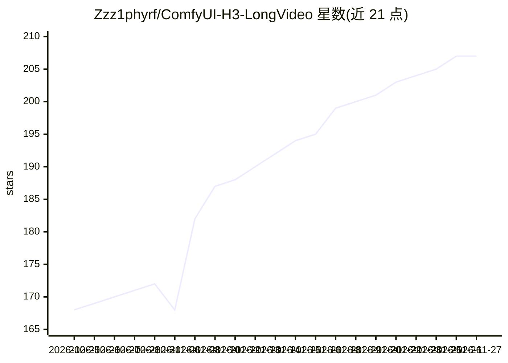

# Zzz1phyrf/ComfyUI-H3-LongVideo

⭐ 207 · Python · 推送 2026-11-20 · [GitHub](https://github.com/Zzz1phyrf/ComfyUI-H3-LongVideo) · 个人维护 · 中文 README

**ComfyUI 长音频分段生成长视频的插件（MV 与口播）**

面向 MiniMax H3 工作流的 ComfyUI 自定义节点插件，提供 MV Generator 与 Talking Avatar 两个控制节点：上传完整音频后进行分段审核、生成、单段重做、预览与合并，支持本地运行或 RunningHub 云端执行两种模式。仓库附带 MV 与口播两份完整示例工作流，Key 保存在本地用户目录，错误日志汇总分段、节点与堆栈信息并脱敏。安装需放入 custom_nodes 并依赖 ffmpeg/ffprobe 与工作流所需节点。

## 筛选速览

| 维度 | 判定 | 备注 |
|---|---|---|
| AI 角色 | `ai-native` | 本体是模型或模型工具 |
| 许可风险 | `none` | — |
| 部署形态 | `None` |  |
| 模型依赖 | — | README 未给出锁定关系 |
| 硬件要求 | — | 无带数字的原话,不猜 |
| 安装摩擦 | `medium` | 含编译或系统依赖之一 |
| 成熟度 | — | 结构信号不足 |

## 能力要点

- 两个控制节点覆盖 MV 与口播两类长视频工作流
- 分段审核、单段重做与旧结果保留的任务管理机制
- 本地与 RunningHub 双执行模式，RH API Key 本地保存
- 附带两份完整示例工作流与统一错误日志下载

## 适用场景

- 用歌曲音频分段生成 MV，逐段编辑分镜与提示词
- 基于人物参考图与口播音频生成长视频数字人
- 使用 RunningHub 云端算力执行分段生成任务

## 场景标签

`视频生成` · 领域:内容生成

## 证据(README 行号)

> L3: MiniMax H3 长音频分段生成插件，包含两个独立控制节点：**MiniMax H3 · MV Generator** 和 **MiniMax H3 · Talking Avatar**。两者均支持本地 / RunningHub
> L22: 示例模型名是参考，必须选择自己环境已有的权重。MV 使用 SelfLift-Avatar、ComfyUI-KJNodes 和 ComfyUI-YCNodes-MiniMax-H3 等画布节点；口播使用 ComfyUI 原生 H3 

## 星数曲线

2026-10-25 168 → 2026-11-27 207（+39）

---
*卡片 v1 · prompt 1.4 · 生成 2026-11-25 · 置信度 high · 依据 README sha `c66609c1d653` · [字段定义](../../DATASET.md)*
