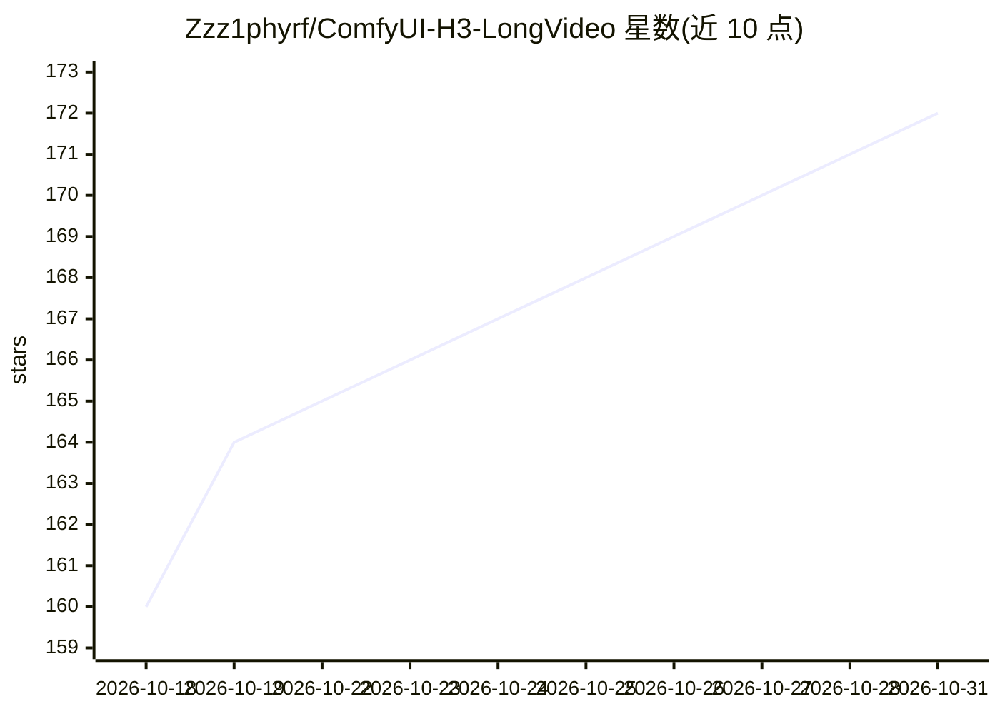

# Zzz1phyrf/ComfyUI-H3-LongVideo

⭐ 172 · Python · 推送 2026-10-30 · [GitHub](https://github.com/Zzz1phyrf/ComfyUI-H3-LongVideo) · 个人维护 · 中文 README

**ComfyUI 长音频分段生成插件：驱动 MiniMax H3 制作唱歌/口播数字人长视频**

面向 ComfyUI 的自定义节点插件，围绕 MiniMax H3 Ref2VA 模型组织长视频工作流：导入音频后自动分析分段、安排镜头（唱歌模式含运镜规划，口播模式为固定构图提示词），提供分段审核面板逐段上传参考图（每段最多 6 张）、编辑导演简报与提示词，确认后顺序生成各段视频并配回原音频合成为完整 MP4。提示词扩写通过 OpenAI 兼容 Chat Completions 接口调用外部模型服务，本地音频分析按需下载语音识别与人声分离模型。需在 ComfyUI 环境中安装，依赖 ffmpeg/ffprobe。

## 筛选速览

| 维度 | 判定 | 备注 |
|---|---|---|
| AI 角色 | `ai-ecosystem` | LLM/agent 周边工具 |
| 许可风险 | `none` | — |
| 部署形态 | `None` |  |
| 模型依赖 | — | README 未给出锁定关系 |
| 硬件要求 | — | 无带数字的原话,不猜 |
| 安装摩擦 | `medium` | 含编译或系统依赖之一 |
| 成熟度 | — | 结构信号不足 |

## 能力要点

- 音频自动分析分段与逐段导演简报编辑
- 每段最多 6 张参考图，支持项目默认图与本段自定义图独立管理
- 顺序生成支持暂停、继续、失败重试与局部重做
- 提示词扩写使用 OpenAI 兼容 API，支持多图 vision 模式与流式 SSE

## 适用场景

- 用 MiniMax H3 制作整首歌曲的唱歌数字人视频
- 制作长篇口播数字人视频并自动拼接成片
- 逐段调整参考图与提示词后局部重做视频片段

## 场景标签

`视频生成` · 领域:内容生成

## 证据(README 行号)

> L3: 用于 MiniMax H3 的长音频分段生成插件，支持唱歌数字人与口播数字人。导入音频后，插件自动分析分段、安排镜头，提供试听和编辑界面；确认后依次生成各段视频，并配回原音频合成为完整成片。
> L19: 1. 将本仓库克隆或解压至 `ComfyUI/custom_nodes/ComfyUI-H3-LongVideo`。
> L23: 5. 在工作流中选择已安装的 MiniMax H3 Ref2VA、LoRA、VAE 和 CLIP 权重，并在插件的“API 设置与模型选择”中配置分镜提示词生成器使用的服务。

## 星数曲线

2026-10-18 160 → 2026-10-31 172（+12）

---
*卡片 v1 · prompt 1.4 · 生成 2026-10-22 · 置信度 high · 依据 README sha `fa2538a5f231` · [字段定义](../../DATASET.md)*
