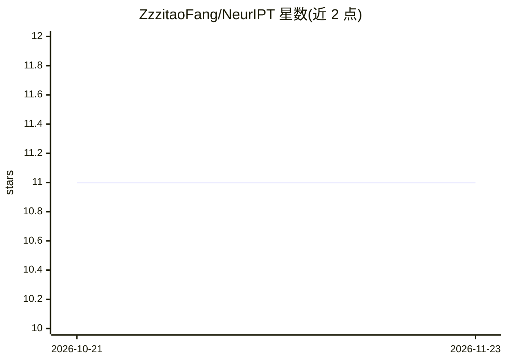

# ZzzitaoFang/NeurIPT

⭐ 11 · MIT · 推送 2026-03-02 · [GitHub](https://github.com/ZzzitaoFang/NeurIPT) · [官网](https://zzzitaofang.github.io/projects/NeurIPT/) · 个人维护

**神经接口领域的基础模型（NeurIPS 2025 论文项目页）**

NeurIPT 是面向神经接口（如 EEG）的基础模型研究项目，论文被 NeurIPS 2025 收录。当前 README 仅为项目占位页：声明页面尚在筹备、将在会议前定稿，代码因校内意外删除正在恢复中。安装方式、运行方法、模型能力细节等均未在 README 中给出，暂无法验证。

## 筛选速览

| 维度 | 判定 | 备注 |
|---|---|---|
| AI 角色 | `ai-native` | 本体是模型或模型工具 |
| 许可风险 | `permissive` | MIT |
| 部署形态 | `None` |  |
| 模型依赖 | — | README 未给出锁定关系 |
| 硬件要求 | — | 无带数字的原话,不猜 |
| 安装摩擦 | `low` | 无编译、无系统依赖或容器化 |
| 成熟度 | `idea` | |

## 能力要点

- NeurIPS 2025 收录论文的基础模型项目页
- 面向神经接口数据（EEG/多变量时间序列）
- README 目前为筹备中的占位页

## 适用场景

- 关注神经接口基础模型研究进展的读者
- 等待代码发布后复现该论文结果

## 场景标签

 · 领域:科研/脑机接口与时间序列建模

## 证据(README 行号)

> L2: [NeurIPS 2025] NeurIPT: Foundation Model for Neural Interfaces
> L6: *Update: Sorry for the delay. The code was accidentally deleted by someone else in the school, and I'm working to re

## 星数曲线

2026-10-21 11 → 2026-11-23 11（+0）

---
*卡片 v1 · prompt 1.4 · 生成 2026-11-18 · 置信度 mid · 依据 README sha `3996479e2a53` · [字段定义](../../DATASET.md)*
