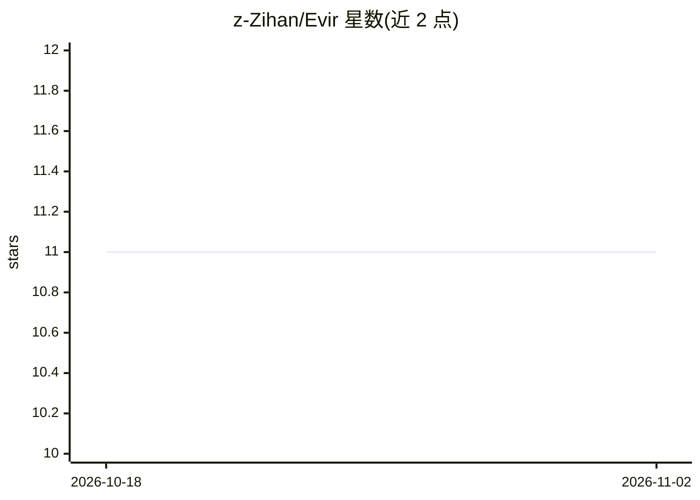

# z-Zihan/Evir

⭐ 11 · TypeScript · 推送 2026-11-01 · [GitHub](https://github.com/z-Zihan/Evir) · 个人维护 · 中文 README

**本地优先 BYOM 桌面项目 Agent：自带模型读改运行验证代码**

基于 Tauri 2 + TypeScript 的本地优先桌面项目代理：用户打开本地项目文件夹，指定任务后由自带模型通过 13 个内置工具与 MCP 工具读取、编辑、执行并验证代码，每步可审批、可回滚，权限边界在工具注册表与 Rust 层强制执行。模型接入支持 7 种协议适配器与 30+ 厂商预设（OpenAI/Anthropic/Gemini/Azure/Ollama 等），API key 存于本地加密保险库；按模型级真实评测划分成熟度层级，目前尚无模型达到 Agent Verified。另含项目知识库（六种来源、带溯源检索）、15 个核心技能与 VS Code/CLI 等多种界面。

## 筛选速览

| 维度 | 判定 | 备注 |
|---|---|---|
| AI 角色 | `ai-native` | 本体是模型或模型工具 |
| 许可风险 | `none` | — |
| 部署形态 | `library` | 以包/库形式分发 |
| 模型依赖 | local-ok | 支持本地模型 |
| 硬件要求 | — | 无带数字的原话,不猜 |
| 安装摩擦 | `low` | 无编译、无系统依赖或容器化 |
| 成熟度 | `idea` | |

## 能力要点

- 桌面项目 Agent：读/改/运行/验证，任务流可审批、diff 可回滚
- 7 种协议适配器与多厂商预设，本地加密保险库存储 API key
- 权限边界在工具注册表与 Rust 层强制执行，非提示词约束
- 模型级真实评测分层（Agent Verified/Eval Candidate/Protocol Verified 等），证据不跨模型复用

## 适用场景

- 让自带模型在本地项目里自主完成编码任务并逐步审批
- 离线/无账号环境下的多模型项目助手
- 对代理行为做溯源审计与知识检索（带出处引用）

## 场景标签

`编码 Agent` · 领域:编码与开发

## 证据(README 行号)

> L9: A clean, local-first, bring-your-own-model **Desktop Project Agent**: open a project, tell Evir what to get done, an
> L18: - **Local-first · bring your own model**: no accounts, credits, or required cloud backend; 7 protocol adapters and 

## 星数曲线

2026-10-18 11 → 2026-11-02 11（+0）

---
*卡片 v1 · prompt 1.4 · 生成 2026-11-01 · 置信度 mid · 依据 README sha `54b028c2b3a8` · [字段定义](../../DATASET.md)*
