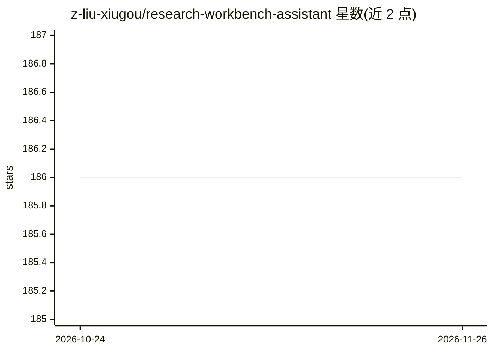

# z-liu-xiugou/research-workbench-assistant

⭐ 186 · Python · Apache-2.0 · 推送 2026-10-29 · [GitHub](https://github.com/z-liu-xiugou/research-workbench-assistant) · 个人维护 · 中文 README

**给研究生的本地科研记录助手：跨对话续接研究进度**

以 Codex Skill 形式安装的本地科研记录工具：用追加式事件台账保存目标、进展、决策、问题、文献笔记与续接断点，Markdown/JSON 双格式落盘，旧记录不改写、修订留痕；附 Crossref 在线文献发现、候选文献队列、只读诊断与备份恢复命令，离线生成 HTML 总览页。基础部分无第三方 Python 依赖，也可不装 Codex 直接用 CLI 验证记录流程。当前为 v0.1.0-alpha 预览版，不保证 AI 内容准确，无全文下载与多来源检索。

## 筛选速览

| 维度 | 判定 | 备注 |
|---|---|---|
| AI 角色 | `ai-enhanced` | 去掉 AI 部分产品仍成立 |
| 许可风险 | `permissive` | Apache-2.0 |
| 部署形态 | `None` |  |
| 模型依赖 | — | README 未给出锁定关系 |
| 硬件要求 | — | 无带数字的原话,不猜 |
| 安装摩擦 | `low` | 无编译、无系统依赖或容器化 |
| 成熟度 | `idea` | |

## 能力要点

- 追加式本地台账：进展、任务、决策、问题、文献等 8 类记录，修订留痕
- 跨对话续接：保存本地断点供新任务读取，非云端记忆
- Crossref 在线文献发现与候选队列，DOI 去重、来源留痕
- 只读诊断 doctor 与备份/恢复命令，离线 HTML 总览页

## 适用场景

- 在 Codex 里记录科研进展，新对话按断点续接
- 用 Crossref 检索论文并维护候选筛选队列
- 把本地 PDF 提取成可检索的离线文献图库（需另装组件）

## 场景标签

`知识库管理` `科研工具` · 领域:知识与检索

## 证据(README 行号)

> L9: 面向研究生的本地科研记录助手，以 Codex Skill 形式使用：记录目标、进展、问题和下一步，在新对话中按需续接；文献笔记保存为 Markdown 和 JSON。
> L21: 需要：可用的本地 Codex、Python 3.10+、Git。基础工作台无第三方 Python 依赖，无需另填 API Key；可选 PDF 图库另装组件。Codex 本身仍需可用账户，可能产生使用费用。
> L133: python -X utf8 skills/research-workbench/scripts/workbench.py init --root demo-workbench --name "示例科研项目"

## 星数曲线

2026-10-24 186 → 2026-11-26 186（+0）

---
*卡片 v1 · prompt 1.4 · 生成 2026-11-26 · 置信度 high · 依据 README sha `fad2dad789c5` · [字段定义](../../DATASET.md)*
