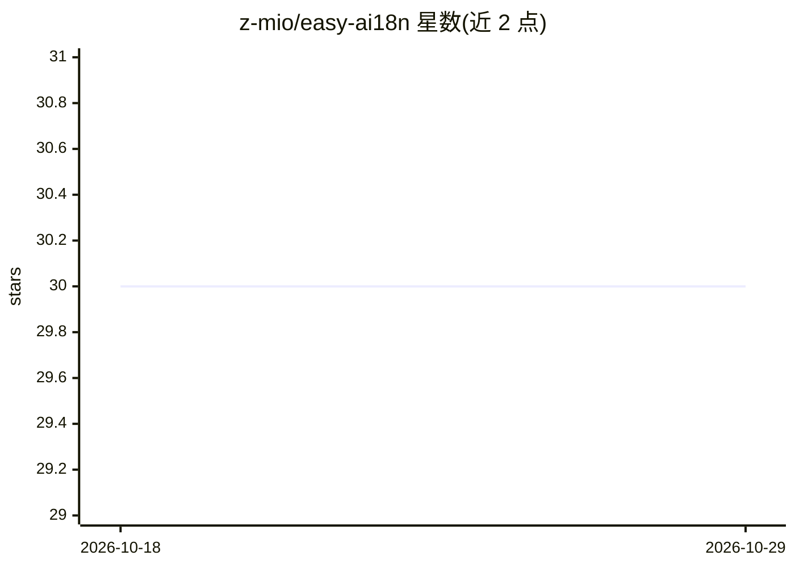

# z-mio/easy-ai18n

⭐ 30 · Python · MIT · 推送 2026-08-18 · [GitHub](https://github.com/z-mio/easy-ai18n) · 个人维护 · 中文 README

**Python3 国际化库：自动提取文案并用 LLM 翻译生成多语言**

面向 Python 开发者的 i18n 库：构建时自动提取代码中可翻译内容，无需手动维护 key 与翻译文件；翻译默认走免费 GoogleTranslator，也可用 LLM 翻译器（批量 LLMBulkTranslator / 单条 LLMItemTranslator），两者均可传入任意 pydantic-ai Agent 以连接本地模型或其他提供商。运行时提供前置/后置语言选择器与 LocaleContent，支持运行期动态切换语言与多用户场景（如 Telegram Bot），完整兼容 Python 字符串格式化语法。以 pip 包形式安装，翻译构建依赖需以 extras 方式加入。

## 筛选速览

| 维度 | 判定 | 备注 |
|---|---|---|
| AI 角色 | `ai-enhanced` | 去掉 AI 部分产品仍成立 |
| 许可风险 | `permissive` | MIT |
| 部署形态 | `library` | 以包/库形式分发 |
| 模型依赖 | — | README 未给出锁定关系 |
| 硬件要求 | — | 无带数字的原话,不猜 |
| 安装摩擦 | `low` | 无编译、无系统依赖或容器化 |
| 成熟度 | — | 结构信号不足 |

## 能力要点

- 自动提取可翻译内容，无需手动维护 key 与 i18n 文件
- LLM 翻译两种模式（批量/单条），支持传入任意 pydantic-ai Agent
- 前置/后置语言选择器支持运行期动态语言切换与多用户场景
- 完整支持 Python 字符串格式化语法与 f-string 插值

## 适用场景

- 给 Python 项目做多语言国际化而不用手工维护翻译文件
- 在 Telegram Bot 等多用户场景按用户语言动态返回译文
- 接入本地或其他 LLM 提供商做批量翻译构建

## 场景标签

 · 领域:开发工具/国际化

## 证据(README 行号)

> L17: Easy AI18n is a modern Python3 internationalization library that supports AI translation, multi-user scenarios, and
> L24: - **🤖 AI Translation:** Supports translation with large language models (LLM) for high-quality results
> L172: **Custom Agent**: both LLM translators support passing any pydantic-ai Agent, so you can connect local models or o

## 星数曲线

2026-10-18 30 → 2026-10-29 30（+0）

---
*卡片 v1 · prompt 1.4 · 生成 2026-10-26 · 置信度 high · 依据 README sha `b022bc555727` · [字段定义](../../DATASET.md)*
