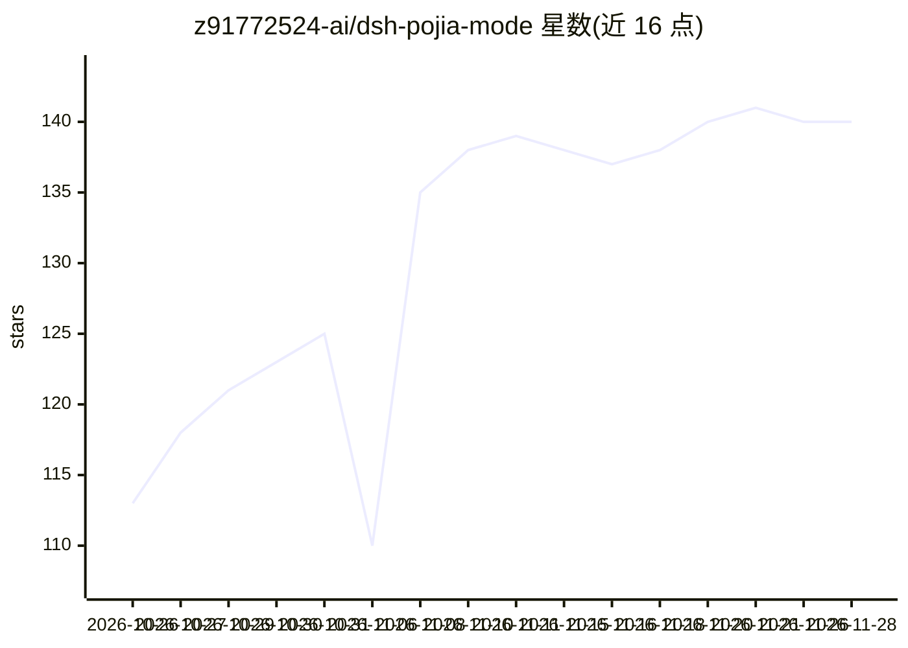

# z91772524-ai/dsh-pojia-mode

⭐ 140 · PowerShell · MIT · 推送 2026-11-24 · [GitHub](https://github.com/z91772524-ai/dsh-pojia-mode) · 个人维护 · 中文 README

**给 DSH 一键安装「破甲模式」preset 的 PowerShell 安装器（已失效存档）**

面向 DSH（DeepSeek Harness）用户的 Windows 安装器：解压后双击 .vbs/.bat 入口，向 $DSH_HOME\.agent-presets\ 写入一份自包含的 agent preset（5182 字符 persona，七块组成），不改 DSH 本体代码与官方 preset 目录。提供 install/dry-run/check/list/diagnose/uninstall 六个命令，带自动备份、卸载移入备份目录、只读动作零落盘等设计；零第三方依赖，仅用系统自带 PowerShell，全程不联网。2026-11 起 DSH 0.2.x 更换 preset 机制，本方案对新版失效，仓库仅存档不再更新。

## 筛选速览

| 维度 | 判定 | 备注 |
|---|---|---|
| AI 角色 | `ai-ecosystem` | LLM/agent 周边工具 |
| 许可风险 | `permissive` | MIT |
| 部署形态 | `desktop` | 安装包/桌面程序 |
| 模型依赖 | — | README 未给出锁定关系 |
| 硬件要求 | — | 无带数字的原话,不猜 |
| 安装摩擦 | `low` | 无编译、无系统依赖或容器化 |
| 成熟度 | `idea` | |

## 能力要点

- 双击 .vbs 静默安装，零第三方依赖、零网络请求
- DSH 数据目录四类来源探测打分，支持 -DshHome 手动指定
- dry-run 只读预演、check 九块自检、diagnose 打印判定依据
- 卸载不移除只移入 _uninstalled- 备份目录，无标记目录拒绝删除

## 适用场景

- 在旧版 DSH 的 preset 选择器中加载自定义 persona 模式
- 需要可回滚、可自检的 preset 安装与卸载流程
- 排查 DSH_HOME 探测与 preset 安装位置问题

## 场景标签

`提示工程` · 领域:Agent 开发

## 证据(README 行号)

> L17: **双击一个文件，你的 DSH（DeepSeek Harness）就多出一个「破甲模式」** —— 不改 DSH 一字节代码、不动官方目录、升级不丢；零依赖（系统自带 PowerShell）、改前自动备份、装完当场可自证、随时可一
> L35: 把 DSH 的「破甲模式」做成**一个可交付的安装器**：一份自包含的 Agent Preset，双击即装，**零第三方依赖**。
> L156: |`$DSH_HOME\.agent-presets\<id>\`|**用户自建**，升级 DSH 不会被覆盖 ← 本工具写这里|

## 星数曲线

2026-10-26 113 → 2026-11-28 140（+27）

---
*卡片 v1 · prompt 1.4 · 生成 2026-11-27 · 置信度 high · 依据 README sha `03aff1c52b57` · [字段定义](../../DATASET.md)*
