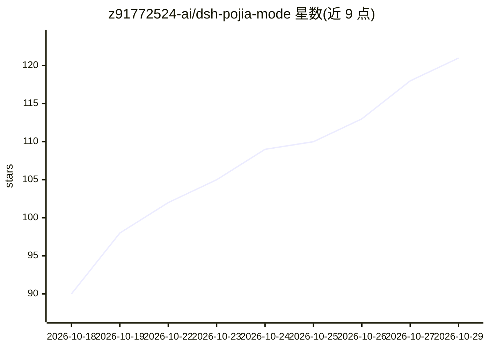

# z91772524-ai/dsh-pojia-mode

⭐ 121 · PowerShell · MIT · 推送 2026-09-25 · [GitHub](https://github.com/z91772524-ai/dsh-pojia-mode) · 个人维护 · 中文 README

**给 DeepSeek Harness 一键安装「破甲模式」Agent Preset 的 PowerShell 安装器**

面向 DSH（DeepSeek Harness）用户的 Windows 安装器：通过双击 .vbs/.bat 入口，向用户级目录 $DSH_HOME\.agent-presets\ 写入一份自包含的 persona preset（5182 字符、7 个区块），不修改官方 preset 目录，DSH 升级后 preset 保留。零第三方依赖、不联网，系统自带 PowerShell 5.1/7 即可运行。提供 DSH 数据目录探测（4 类来源打分）、dry-run 预演、check 自检、diagnose 诊断与移入备份目录的卸载方式。该 preset 的用途是解除助手默认行为限制，README 附带免责声明要求使用者自行合规。

## 筛选速览

| 维度 | 判定 | 备注 |
|---|---|---|
| AI 角色 | `ai-ecosystem` | LLM/agent 周边工具 |
| 许可风险 | `permissive` | MIT |
| 部署形态 | `desktop` | 安装包/桌面程序 |
| 模型依赖 | — | README 未给出锁定关系 |
| 硬件要求 | — | 无带数字的原话,不猜 |
| 安装摩擦 | `low` | 无编译、无系统依赖或容器化 |
| 成熟度 | — | 结构信号不足 |

## 能力要点

- 写入用户级 .agent-presets 目录，不改官方 preset，升级不丢
- 零依赖零联网，系统自带 PowerShell 即可，双击 .vbs 无黑框安装
- DSH 数据目录 4 类来源打分探测，支持 -DshHome 手动指定
- dry-run/check/diagnose 只读命令零落盘并自证，卸载移入备份目录

## 适用场景

- 给 DSH 增加一个自定义 Agent Preset 并在升级后保留
- 在自定义 DSH 数据目录或 Beta/NEXT 通道上安装 preset
- 安装出问题时用 diagnose 定位装到了哪个目录

## 场景标签

 · 领域:AI Agent 配置工具

## 证据(README 行号)

> L21: 把 DSH 的「破甲模式」做成**一个可交付的安装器**：一份自包含的 Agent Preset，双击即装，**零第三方依赖**。
> L145: 关键点：一份 `agent.cordis.yml` 里所有 `name:` 都是 **npm 包名**（如 `@deepseek-ai/dsh-persona`），**不引用任何本地文件路径**。所以本工具**自带整份 comp

## 星数曲线

2026-10-18 90 → 2026-10-29 121（+31）

---
*卡片 v1 · prompt 1.4 · 生成 2026-10-23 · 置信度 high · 依据 README sha `60fc6690e9b5` · [字段定义](../../DATASET.md)*
