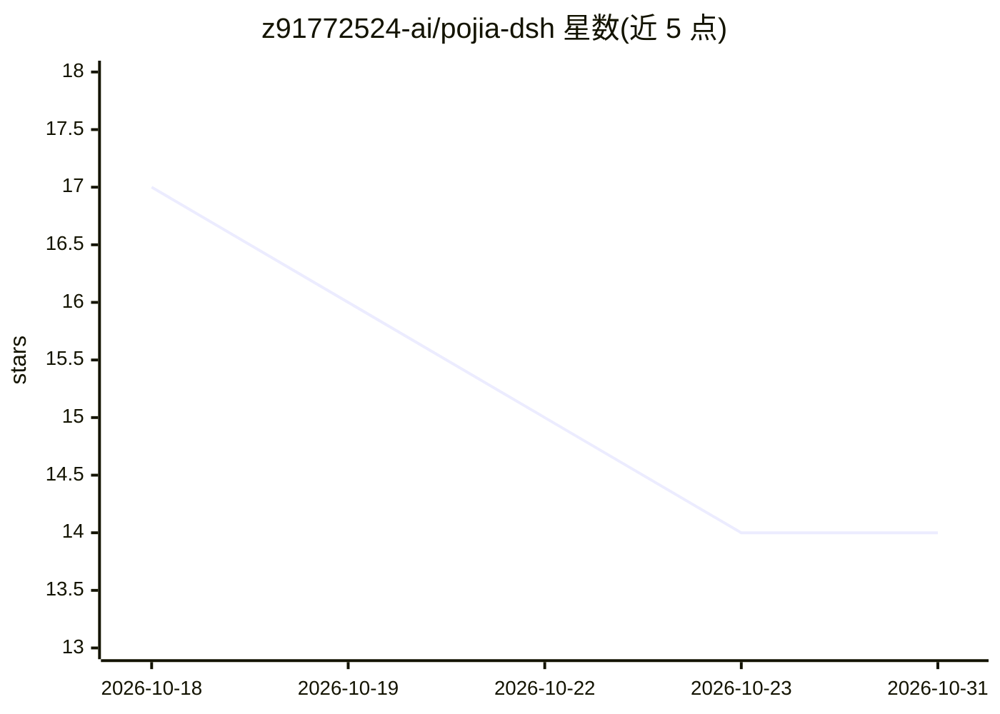

# z91772524-ai/pojia-dsh

⭐ 14 · Python · MIT · 推送 2026-09-30 · [GitHub](https://github.com/z91772524-ai/pojia-dsh) · 个人维护 · 中文 README

**给 DeepSeek Harness 写入操作者人格配置的本地脚本**

面向 DeepSeek Harness（DSH）桌面客户端用户的 Windows 脚本：通过 DSH 官方的用户全局指令文件通道（$DSH_HOME\AGENTS.md）注入一份操作者人格与宽松政策配置，使下一句对话即生效而无需重启。只写用户自己的文件、不改动官方安装目录，改前自动备份并支持 --revert 还原。纯 Python 标准库实现，零依赖、全程不联网。支持新版（asar 打包）与旧版 DSH 的结构探测，L2 系统提示词层为计划中未发布。

## 筛选速览

| 维度 | 判定 | 备注 |
|---|---|---|
| AI 角色 | `ai-ecosystem` | LLM/agent 周边工具 |
| 许可风险 | `permissive` | MIT |
| 部署形态 | `library` | 以包/库形式分发 |
| 模型依赖 | locked-api |  |
| 硬件要求 | — | 无带数字的原话,不猜 |
| 安装摩擦 | `low` | 无编译、无系统依赖或容器化 |
| 成熟度 | `idea` | |

## 能力要点

- 走官方 AGENTS.md 通道，改完下一句对话即生效、无需重启
- 只写用户目录文件，改前自动备份、--revert 一键还原
- 纯 Python 标准库、零依赖、零网络请求
- --status/--check/--dry-run 只读模式磁盘零变化（回归测试断言）

## 适用场景

- 给本机 DSH 客户端注入自定义操作者人格配置
- 通过命令行检测 DSH 安装状态与版本
- 改完配置后随时还原到原始状态

## 场景标签

`提示工程` · 领域:Agent 开发

## 证据(README 行号)

> L3: **双击一个文件，你的 DeepSeek Harness 就带上一套「不拒绝、不中途停、全力执行」的操作者人格** —— 只写你自己的文件、官方安装目录一个字节不碰、改前自动备份、随时一键还原；**改完下一句对话就生效，不用重启。*
> L29: - ⚡ **不用重启** —— 走 DSH 官方的「用户全局指令文件」通道（`agent-instructions`），写完**下一句对话**就生效。旧方案要退出整个客户端再重开。
> L161: 本项目通过向 DeepSeek Harness 的**用户数据目录**写入一份用户级指令文件，来改变该软件默认的助手行为。使用者应当：

## 星数曲线

2026-10-18 17 → 2026-10-31 14（-3）

---
*卡片 v1 · prompt 1.4 · 生成 2026-10-31 · 置信度 mid · 依据 README sha `da678bf9057b` · [字段定义](../../DATASET.md)*
