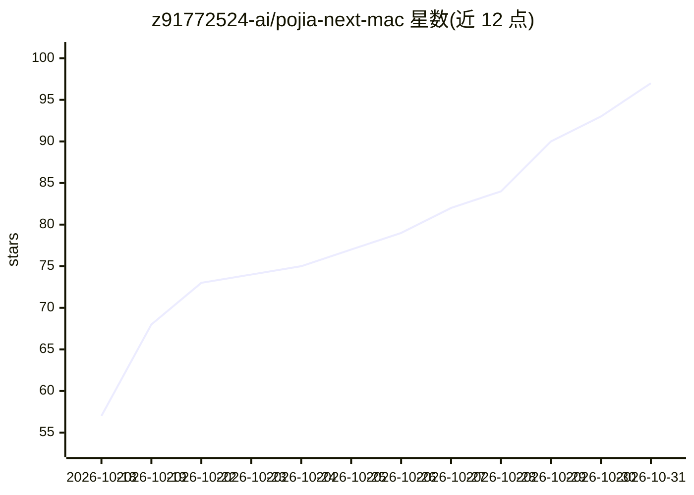

# z91772524-ai/pojia-next-mac

⭐ 97 · Python · MIT · 推送 2026-10-10 · [GitHub](https://github.com/z91772524-ai/pojia-next-mac) · 个人维护 · 中文 README

**macOS 工具：替换 WorkBuddy/Codex 客户端内置提示词为用户自写人格**

pojia-next 的 macOS 移植版，以纯 Python 标准库 + Bash 脚本替换 WorkBuddy 与 Codex 两个 AI 客户端内部不可编辑的提示词/政策文本：WorkBuddy 端为六层靶点（模板政策块、product.json、命令钩子、插件副本、运行时缓存、云记忆 memoryBlock），Codex 端为 config.toml 与 AGENTS.md 双锚点；一份 persona.md 两端共用。零第三方依赖、零网络请求，改动前自动备份（.pojiabak）并支持一键还原；含加密保护块与源码级封条，文件被改即拒绝运行。上游覆盖六个客户端，本版仅覆盖 macOS 可用的两个。

## 筛选速览

| 维度 | 判定 | 备注 |
|---|---|---|
| AI 角色 | `ai-ecosystem` | LLM/agent 周边工具 |
| 许可风险 | `permissive` | MIT |
| 部署形态 | `None` |  |
| 模型依赖 | — | README 未给出锁定关系 |
| 硬件要求 | — | 无带数字的原话,不猜 |
| 安装摩擦 | `low` | 无编译、无系统依赖或容器化 |
| 成熟度 | — | 结构信号不足 |

## 能力要点

- WorkBuddy 六层靶点 + Codex 双锚点的提示词替换
- 纯 Python 标准库 + Bash，零第三方依赖、零网络请求
- 改前自动备份 .pojiabak，一条命令还原官方原版
- 加密保护块 + INTEGRITY_ANCHOR 封条，改文件任意一行即拒绝运行（退出码 3）

## 适用场景

- 把 WorkBuddy / Codex 的默认身份设定换成自己写的 persona.md
- 通过固定口令验证注入是否真的生效
- 先 --dry-run 预演改动，不满意时按备份一键还原

## 场景标签

`提示工程` · 领域:Agent 开发

## 证据(README 行号)

> L29: 这个脚本做的事很简单：**把那段规矩，换成你自己写的一份。**
> L125: WorkBuddy 端是**六层靶点**，逐层替换/解锁：

## 星数曲线

2026-10-18 57 → 2026-10-31 97（+40）

---
*卡片 v1 · prompt 1.4 · 生成 2026-10-24 · 置信度 high · 依据 README sha `58ddd70ce9d2` · [字段定义](../../DATASET.md)*
