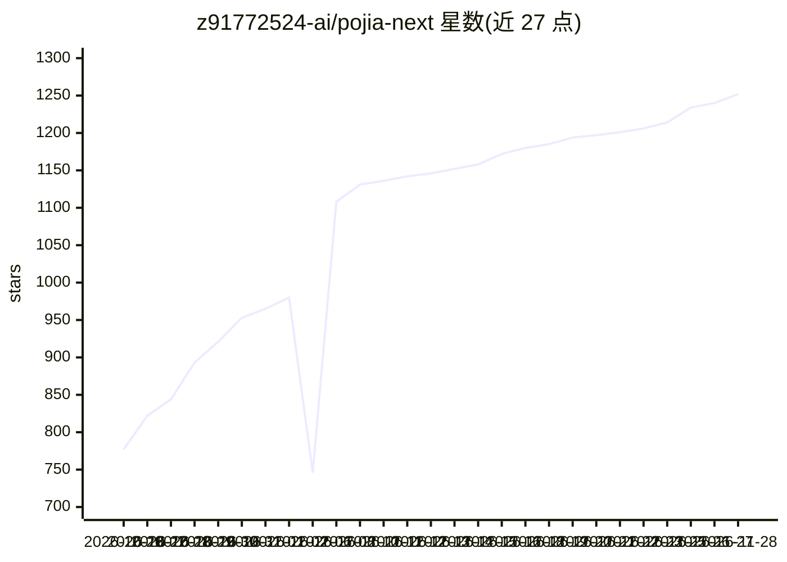

# z91772524-ai/pojia-next

⭐ 1,252 · MIT · 推送 2026-11-27 · [GitHub](https://github.com/z91772524-ai/pojia-next) · [官网](https://github.com/z91772524-ai/pojia-next/releases/latest) · 个人维护 · 中文 README

**一键替换 DSH/WorkBuddy/ZCode/Codex 四个 AI 客户端内置提示词的 Windows 工具**

读取本机已安装的 DSH、WorkBuddy、ZCode、Codex 四个 AI 客户端的本地提示词文件，将其内置系统提示词替换为用户自定义的 persona.md 人格文件。提供图形界面与命令行两种入口，支持改前备份、演练（只读预览）、一键还原、固定口令自检验证补丁真实生效；DSH 三层补丁、WorkBuddy 六层靶点加云记忆通道、ZCode 技能目录与 AGENTS.md、Codex 替换 config.toml 指令文件。限制：仅支持 Windows 与上述四个客户端；仓库只发布成品 exe，源码不随仓库分发；需激活码（5 元）在官方群领取，非订阅；README 自述修改第三方客户端处于使用条款灰色地带，账号风险自负。

## 筛选速览

| 维度 | 判定 | 备注 |
|---|---|---|
| AI 角色 | `ai-enhanced` | 去掉 AI 部分产品仍成立 |
| 许可风险 | `permissive` | MIT |
| 部署形态 | `desktop` | 安装包/桌面程序 |
| 模型依赖 | — | README 未给出锁定关系 |
| 硬件要求 | — | 无带数字的原话,不猜 |
| 安装摩擦 | `low` | 无编译、无系统依赖或容器化 |
| 成熟度 | — | 结构信号不足 |

## 能力要点

- 四个客户端一份 persona.md 口径，改前自动备份、护照名单精确还原
- 演练模式只读不写盘，固定口令自检验证补丁真实载入
- WorkBuddy 云记忆 memoryBlock 注入通道带版本号与只读防护
- 核心承诺零网络请求，CI 每次提交自动跑三套安全扫描

## 适用场景

- 把 AI 客户端默认系统提示词换成自己写的人格设定
- 四个客户端统一提示词口径，避免各改各的前后矛盾
- 客户端升级后补丁被冲掉时一键重打并自检

## 场景标签

`提示工程` · 领域:Agent 开发

## 证据(README 行号)

> L30: **一句话：把你电脑上那几个 AI 客户端「自己改不到的内置提示词」，换成你自己写的那份 —— 双击 exe、点一个按钮的事。**
> L46: 支持 **DSH / WorkBuddy / ZCode / Codex** 四个客户端，一个工具全管，口径完全一致。
> L79: > **它不修改软件本体**：只做**文本文件层面的替换**，不删包、不碰注册表 / 服务。

## 星数曲线

2026-10-26 777 → 2026-11-28 1,252（+475）

---
*卡片 v1 · prompt 1.4 · 生成 2026-11-26 · 置信度 mid · 依据 README sha `b19cfd99ca86` · [字段定义](../../DATASET.md)*
