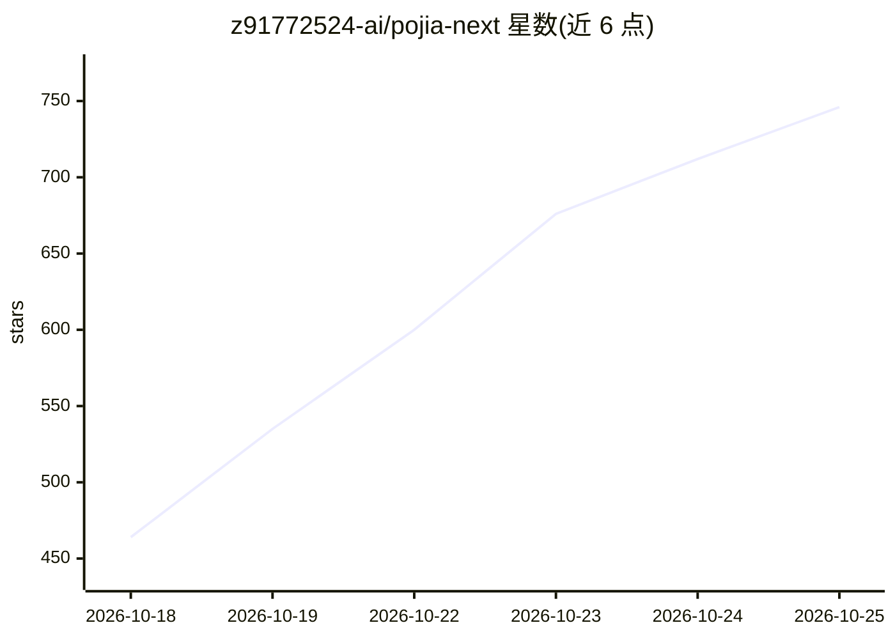

# z91772524-ai/pojia-next

⭐ 777 · Python · MIT · 推送 2026-10-25 · [GitHub](https://github.com/z91772524-ai/pojia-next) · 个人维护 · 中文 README

**给普通用户：一键替换十五个 AI 编程客户端的内置提示词与人格**

Windows 桌面工具（单文件 exe 或 Python 源码运行，零第三方依赖），对 DSH/WorkBuddy/ZCode/Codex/Cursor/Claude Code 等 15 个 AI 客户端做文件级补丁：用用户自写的 persona.md 替换或注入官方默认身份与系统提示词，采用标记块、config.toml 指针、云记忆档案等按客户端差异化的注入方式。每次改动先备份、支持护照名单精确还原与只读演练，附带环境检测、技能安装页与 bandit/semgrep CI 扫描、SHA256 校验。exe 首次使用需输入 QQ 群号在线验证后获取核心。

## 筛选速览

| 维度 | 判定 | 备注 |
|---|---|---|
| AI 角色 | `ai-ecosystem` | LLM/agent 周边工具 |
| 许可风险 | `permissive` | MIT |
| 部署形态 | `desktop` | 安装包/桌面程序 |
| 模型依赖 | — | README 未给出锁定关系 |
| 硬件要求 | — | 无带数字的原话,不猜 |
| 安装摩擦 | `low` | 无编译、无系统依赖或容器化 |
| 成熟度 | — | 结构信号不足 |

## 能力要点

- 覆盖 15 个 AI 编程客户端的提示词/人格替换，统一 persona.md 口径
- 每次改动先备份，护照名单精确还原，演练模式纯只读
- 核心零网络请求、零动态执行、零 shell 拼串，CI 自动断言
- 单文件 exe 免装 Python，或两份 .py 源码直接运行

## 适用场景

- 把 Cursor/Claude Code 等客户端的内置身份提示词换成自己写的版本
- 用一份人格文件统一管理多个 AI 编程工具的口径
- 官方客户端升级后重新打补丁并自检是否生效

## 场景标签

`提示工程` · 领域:Agent 开发

## 证据(README 行号)

> L5: 支持 **DSH / WorkBuddy / ZCode / Codex / Cursor / Claude Code / Gemini CLI / Qwen Code / iFlow / Trae / CodeBuddy / Op
> L29: 你平时用的 AI 客户端（比如 WorkBuddy、DSH），每次对话时都会在背后塞一段**你自己改不到的"规矩"**
> L41: > **它不修改软件本体**：只做**文本文件层面的替换**，不删包、不碰注册表 / 服务。

## 星数曲线

2026-10-18 464 → 2026-10-25 746（+282）

---
*卡片 v1 · prompt 1.4 · 生成 2026-10-21 · 置信度 mid · 依据 README sha `8d00996d791b` · [字段定义](../../DATASET.md)*
