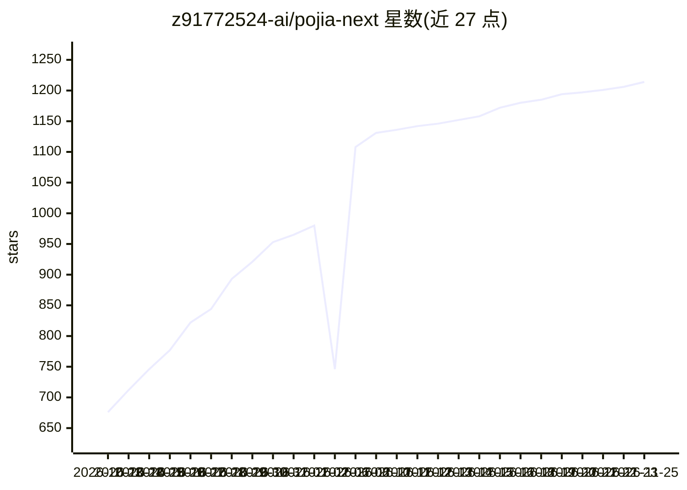

# z91772524-ai/pojia-next

⭐ 1,214 · MIT · 推送 2026-11-22 · [GitHub](https://github.com/z91772524-ai/pojia-next) · [官网](https://1pojia.cn/) · 个人维护 · 中文 README

**为四个 AI 客户端一键替换内置系统提示词的 Windows 工具**

破甲一键通针对 DSH / WorkBuddy / ZCode / Codex 四个 AI 客户端，将其内置的系统提示词文件替换为用户自写的 persona.md，并保持四个客户端口径一致。机制上：只做文本文件层面的补丁（不删包、不碰注册表/服务），改前自动备份、写盘原子化、按护照名单精确还原；提供固定口令自检验证提示词真载入；支持演练（只读预览）与守护任务自愈。分发形式为单文件 exe（不装 Python），仓库只发成品、源码不随仓库分发；核心逻辑经验证后从官方服务器拉取，需官网自助领取激活码并完成群验证。README 提示该工具处于客户端使用条款灰色地带，账号风险自负。

## 筛选速览

| 维度 | 判定 | 备注 |
|---|---|---|
| AI 角色 | `ai-enhanced` | 去掉 AI 部分产品仍成立 |
| 许可风险 | `permissive` | MIT |
| 部署形态 | `desktop` | 安装包/桌面程序 |
| 模型依赖 | — | README 未给出锁定关系 |
| 硬件要求 | — | 无带数字的原话,不猜 |
| 安装摩擦 | `low` | 无编译、无系统依赖或容器化 |
| 成熟度 | — | 结构信号不足 |

## 能力要点

- 四客户端统一 persona.md 提示词替换，文件级补丁不改软件本体
- 改前备份 + 护照驱动精确还原 + 固定口令自检验证生效
- 演练模式纯只读预览，核心零网络请求（CI 断言）
- 单文件 exe 免装 Python，双击即用

## 适用场景

- 给 DSH/WorkBuddy/ZCode/Codex 换成自己写的身份设定
- 官方升级冲掉补丁后一键重打并自动识别
- 需要可回滚、可自证的方式修改客户端内置提示词

## 场景标签

`提示工程` · 领域:Agent 开发

## 证据(README 行号)

> L32: **一句话：把你电脑上那几个 AI 客户端「自己改不到的内置提示词」，换成你自己写的那份 —— 双击 exe、点一个按钮的事。**
> L48: 支持 **DSH / WorkBuddy / ZCode / Codex** 四个客户端，一个工具全管，口径完全一致。
> L49: **图形界面（原生窗口）+ 单文件 exe**：不装 Python、不敲命令、不进浏览器；

## 星数曲线

2026-10-23 676 → 2026-11-25 1,214（+538）

---
*卡片 v1 · prompt 1.4 · 生成 2026-11-23 · 置信度 mid · 依据 README sha `e57dfb4e8e8e` · [字段定义](../../DATASET.md)*
