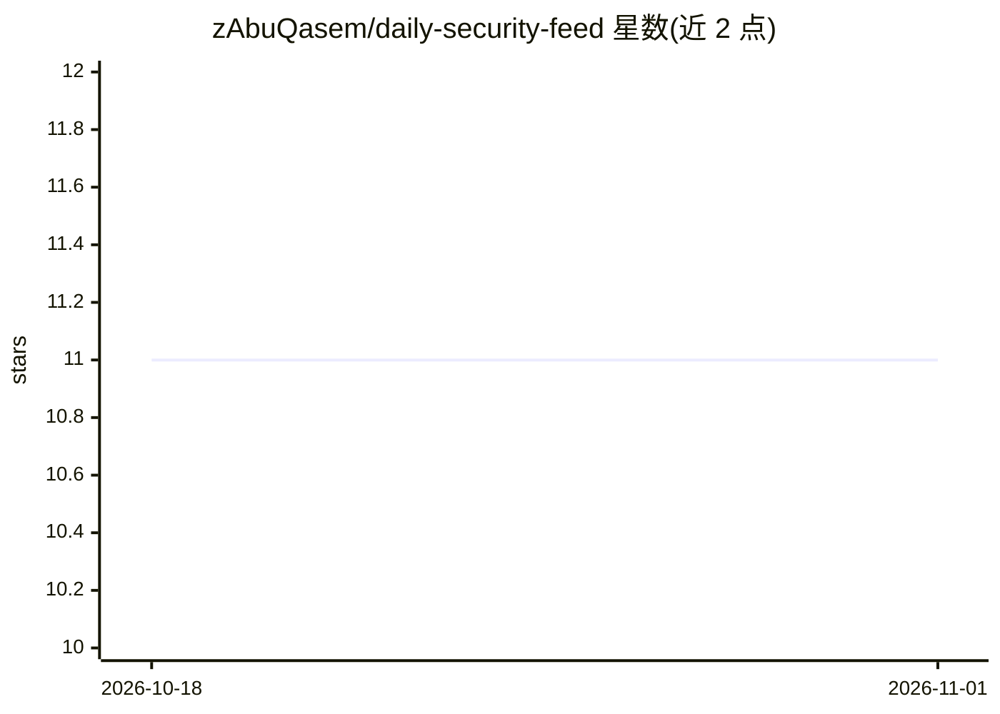

# zAbuQasem/daily-security-feed

⭐ 11 · Python · NOASSERTION · 推送 2026-10-26 · [GitHub](https://github.com/zAbuQasem/daily-security-feed) · [官网](https://zabuqasem.github.io/daily-security-feed/) · 个人维护

**AI 分类安全资讯 RSS 聚合管道，日更发布并推送 Discord/Slack**

基于 GitHub Actions 的定时管道：每日抓取 feeds.yaml 中的 RSS/Atom 源（300+ 条描述），经 AI 分类器筛选并按优先级生成安全研究 feed，部署到 GitHub Pages，可选推送 Discord/Slack webhook。分类后端支持 GitHub Copilot 或 Anthropic Claude，可设 SKIP_CLASSIFY 跳过 AI 直接发布。针对不可信文章内容实现多层提示注入防御（8 层归一化的注入扫描器、提示指令隔离、输出校验等），并明确声明不保证完全防护。使用方式为 fork 本仓库并配置 secrets 与 feeds。

## 筛选速览

| 维度 | 判定 | 备注 |
|---|---|---|
| AI 角色 | `ai-enhanced` | 去掉 AI 部分产品仍成立 |
| 许可风险 | `none` | NOASSERTION |
| 部署形态 | `None` |  |
| 模型依赖 | locked-api |  |
| 硬件要求 | — | 无带数字的原话,不猜 |
| 安装摩擦 | `low` | 无编译、无系统依赖或容器化 |
| 成熟度 | — | 结构信号不足 |

## 能力要点

- 每日定时抓取 RSS/Atom 并经 AI 分类生成优先级 feed
- 分类后端可选 GitHub Copilot 或 Claude（claude-sonnet-4 默认）
- 多层间接提示注入防御：8 层归一化启发式扫描、14 种语言模式匹配、隔离可疑文章
- 可选 Discord/Slack webhook 通知，支持多频道分发

## 适用场景

- 我要一个每日自动更新的安全研究资讯站
- 团队想在 Discord/Slack 收到按优先级筛选的安全资讯
- 安全研究者自建可定制 RSS 源的聚合过滤管道

## 场景标签

`网络安全` `工作流自动化` · 领域:效率与自动化

## 证据(README 行号)

> L10: AI-curated security research feed — auto-updated daily, deployed to GitHub Pages. Supports **GitHub Copilot** or **
> L52: |`SKIP_CLASSIFY`|`true` or `false`|Skip AI classification — publish all fetched articles (default: `false`)|

## 星数曲线

2026-10-18 11 → 2026-11-01 11（+0）

---
*卡片 v1 · prompt 1.4 · 生成 2026-11-01 · 置信度 mid · 依据 README sha `464c0c348d52` · [字段定义](../../DATASET.md)*
