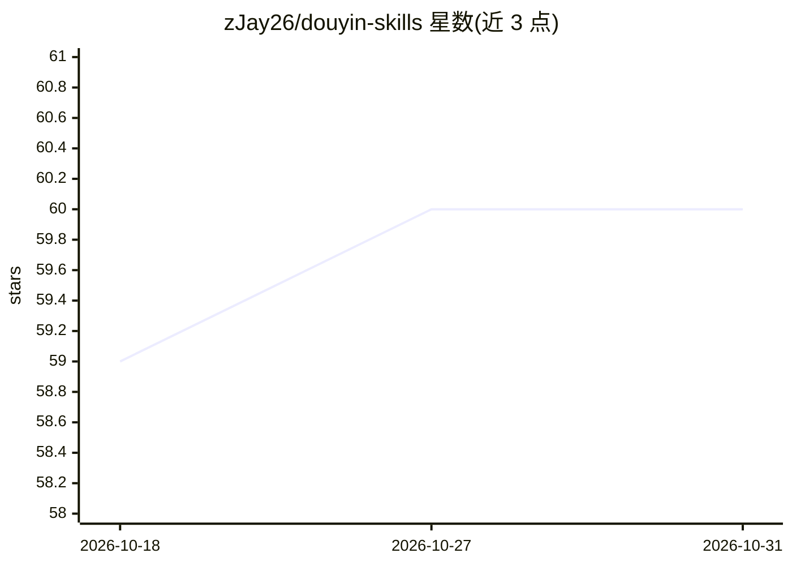

# zJay26/douyin-skills

⭐ 60 · Python · MIT · 推送 2026-10-01 · [GitHub](https://github.com/zJay26/douyin-skills) · 个人维护 · 中文 README

**面向 agent 的抖音网页操作技能包：本地浏览器执行、人工确认**

以开源 Agent Skills 格式提供 5 个可组合 Skill（登录/搜索/发布/互动/环境诊断），让 OpenClaw 等 agent 客户端通过结构化 JSON CLI 驱动本地 Chrome 完成抖音登录态检查、关键词搜索、热搜读取、图文/视频表单填写与单次评论点赞等操作。会话保存在本机隔离 Chrome profile，CDP 调试端口仅监听 127.0.0.1；发布需页面校验与显式确认，风险页或不确定结果停等人工处理。当前仅实现抖音适配，明确声明非抖音官方产品、不做批量互动。

## 筛选速览

| 维度 | 判定 | 备注 |
|---|---|---|
| AI 角色 | `ai-ecosystem` | LLM/agent 周边工具 |
| 许可风险 | `permissive` | MIT |
| 部署形态 | `desktop` | 安装包/桌面程序 |
| 模型依赖 | — | README 未给出锁定关系 |
| 硬件要求 | — | 无带数字的原话,不猜 |
| 安装摩擦 | `medium` | 含编译或系统依赖之一 |
| 成熟度 | `idea` | |

## 能力要点

- 5 个可组合 Skill 覆盖登录、搜索、发布、互动与环境诊断
- 本地 Chrome 隔离 profile，调试端点仅监听 127.0.0.1
- 发布需显式确认；confirmed/unconfirmed/unavailable 状态区分
- 根 SKILL.md 遵循开放 Agent Skills 规范，OpenClaw 提供文档化安装路径

## 适用场景

- 让 agent 在本地浏览器里检查抖音登录并展示二维码
- 用自然语言搜索公开帖子、读取热点话题
- 让 agent 预填发布表单，人工审核后再确认发布
- 作为 risk-sensitive 网页操作的 human-in-the-loop 模式参考

## 场景标签

`浏览器自动化` · 领域:效率与自动化

## 证据(README 行号)

> L23: `douyin-skills` is a concrete attempt to make that boundary easier to inspect and reuse. It packages intent as vers
> L158: The root `SKILL.md` follows the open Agent Skills specification, which is designed for portable, version-controlle

## 星数曲线

2026-10-18 59 → 2026-10-31 60（+1）

---
*卡片 v1 · prompt 1.4 · 生成 2026-10-24 · 置信度 high · 依据 README sha `5c2dd91b17f5` · [字段定义](../../DATASET.md)*
