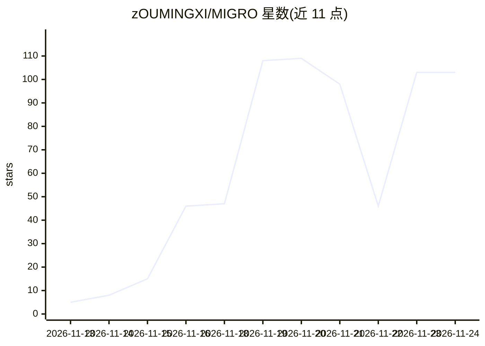

# zOUMINGXI/MIGRO

⭐ 103 · Python · Apache-2.0 · 推送 2026-11-17 · [GitHub](https://github.com/zOUMINGXI/MIGRO) · [官网](https://zoumingxi.github.io/MIGRO/) · 组织维护 · 中文 README

**语言模型跨模型迁移的持久长期记忆系统**

面向语言模型的长期记忆基础设施：将观察、历史关系与检索地址存入持久状态，使更换模型后仍可读取并继续写入。提供状态迁移与全历史重建两种操作，通过词表感知传输与读接口校准连接新宿主模型。以 Python 源码仓库发布，包含持久状态后端、精确编码内核与评测入口；骨干模型与重排序模型需另行获取。附 arXiv 技术报告与交互式演示，在 Qwen 4B→Mistral 7B 迁移等任务上报告评测结果。

## 筛选速览

| 维度 | 判定 | 备注 |
|---|---|---|
| AI 角色 | `ai-ecosystem` | LLM/agent 周边工具 |
| 许可风险 | `permissive` | Apache-2.0 |
| 部署形态 | `desktop` | 安装包/桌面程序 |
| 模型依赖 | — | README 未给出锁定关系 |
| 硬件要求 | — | 无带数字的原话,不猜 |
| 安装摩擦 | `low` | 无编译、无系统依赖或容器化 |
| 成熟度 | — | 结构信号不足 |

## 能力要点

- 持久状态支持跨模型状态迁移与全历史重建两种操作
- 词表感知分段传输与读接口校准连接接收模型
- 持久状态后端、编码内核与基准评测入口均随仓库发布
- 共享检查点与数据集经 Hugging Face 分发，骨干模型需自行获取

## 适用场景

- 模型升级时保留既有对话记忆并继续写入
- 跨模型迁移后评测回答质量与记忆占用
- 研究长期记忆系统的传输与校准机制

## 场景标签

`Agent 记忆` `模型评测` · 领域:Agent 开发

## 证据(README 行号)

> L26: **MIGRO keeps long-term experience available as language models change.** It stores observations, historical relati
> L52: **Run the memory system.** Follow runtime setup to install runtime dependencies, download shared assets, compile th
> L78: **The read interface handles the receiving host.** Lexical transport connects source representations to the target 

## 星数曲线

2026-11-13 5 → 2026-11-24 103（+98）

---
*卡片 v1 · prompt 1.4 · 生成 2026-11-18 · 置信度 high · 依据 README sha `d4bfc24dbfa9` · [字段定义](../../DATASET.md)*
