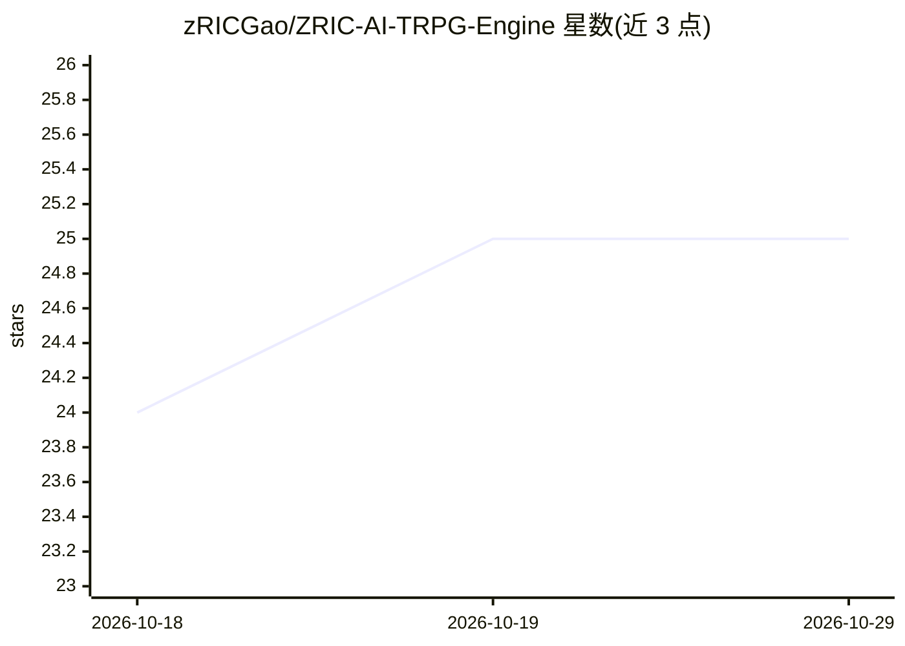

# zRICGao/ZRIC-AI-TRPG-Engine

⭐ 25 · HTML · NOASSERTION · 推送 2026-10-16 · [GitHub](https://github.com/zRICGao/ZRIC-AI-TRPG-Engine) · [官网](https://github.com/zRICGao/ZRIC-AI-TRPG-Engine) · 个人维护 · 中文 README

**大模型驱动的 AI 跑团/文字冒险推演引擎，供 GM 与玩家**

面向跑团主持人与文字冒险玩家的 DM 在环推演引擎：输入玩家行动后由 LLM（DeepSeek/Claude）生成含数值变化、物品与地图移动的多分支剧情；内置三级记忆（工作区/实体档案/向量长期记忆）、RAG 世界观知识库、NPC 情绪状态机与 Persona 对话、触发器收束、场景生图（Kolors/豆包）及 WebSocket 投屏与手机短信模拟界面。附示例剧本，Python 源码运行，需 DeepSeek 与硅基流动 API Key，README 自述处于早期开发阶段、请勿用于生产环境。

## 筛选速览

| 维度 | 判定 | 备注 |
|---|---|---|
| AI 角色 | `ai-native` | 本体是模型或模型工具 |
| 许可风险 | `none` | NOASSERTION |
| 部署形态 | `library` | 以包/库形式分发 |
| 模型依赖 | locked-api |  |
| 硬件要求 | — | 无带数字的原话,不猜 |
| 安装摩擦 | `low` | 无编译、无系统依赖或容器化 |
| 成熟度 | `idea` | |

## 能力要点

- LLM 生成 2-4 分支剧情，含 HP/SAN、物品、地图移动副作用
- 三级记忆结构：短期工作区→实体档案→向量长期记忆
- NPC 情绪三轴状态机与 MBTI Persona 独立记忆
- RAG 知识库语义检索注入 prompt，剧本存档含向量索引

## 适用场景

- 我跑文字冒险团时让 AI 承接玩家自由行动并推演分支剧情
- 带 NPC 短信对话与投屏的桌面跑团会话
- 用触发器引导 AI 叙事走向设计好的关键节点

## 场景标签

 · 领域:游戏/互动叙事

## 证据(README 行号)

> L8: DM在环的半自动文字冒险推演模拟器。AI 实时生成多分支剧情、自动管理 NPC 情绪、语义检索知识库裁判规则、场景感知生图、投屏同步给玩家。
> L17: - **AI 推演**：输入玩家行动，AI 生成 2-4 个分支结果（含 HP/SAN 变化、物品获取、地图移动），支持流式输出
> L156: 该引擎的主要运作模式：人负责构造基本规则和主世界观（背景故事、主要人物、主线、地图等），然后由 AI 承接玩家的自由行动推演剧情走向，摆脱传统电脑游戏的有限分支。

## 星数曲线

2026-10-18 24 → 2026-10-29 25（+1）

---
*卡片 v1 · prompt 1.4 · 生成 2026-10-26 · 置信度 mid · 依据 README sha `d2a3434c0fa5` · [字段定义](../../DATASET.md)*
