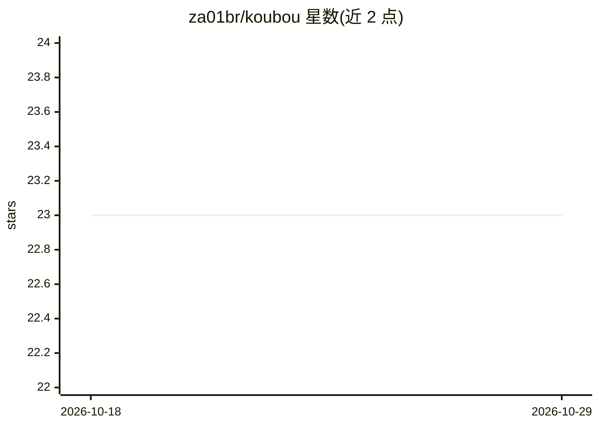

# za01br/koubou

⭐ 23 · TypeScript · MIT · 推送 2026-04-01 · [GitHub](https://github.com/za01br/koubou) · [官网](https://koubou.app/) · 个人维护

**自带 API Key 的 AI 图像模型探索画布（文生图/图生图）**

开源的无限画布式 Web 应用，用户自带 API Key（BYOK）调用 AI 图像模型：支持文本生成图像、图像编辑（选中一张或多张图后输入提示词提交）、图片上传与剪贴板粘贴、拖拽缩放、多选与删除。技术栈为 Bun + Vite + React + TypeScript + Shadcn UI/Tailwind CSS，可在线试用（koubou.app）或本地克隆后用 bun install / bun dev 运行。V2 路线图列出了接入 OpenAI、Replicate、fal.ai 等更多服务。使用 Nano Banana API 需开启 Google 计费。

## 筛选速览

| 维度 | 判定 | 备注 |
|---|---|---|
| AI 角色 | `ai-native` | 本体是模型或模型工具 |
| 许可风险 | `permissive` | MIT |
| 部署形态 | `None` |  |
| 模型依赖 | — | README 未给出锁定关系 |
| 硬件要求 | — | 无带数字的原话,不猜 |
| 安装摩擦 | `low` | 无编译、无系统依赖或容器化 |
| 成熟度 | — | 结构信号不足 |

## 能力要点

- 文本生成图像与图像编辑（单图/多图选择）
- 无限画布，支持平移缩放、拖拽调整大小
- 上传与剪贴板粘贴图片，右键下载
- BYOK 模式，本地运行仅需 Bun

## 适用场景

- 在画布上用提示词生成和编辑 AI 图像
- 对比多个模型在同一画布上的图像输出
- 本地部署一个可自托管的 AI 图像生成前端

## 场景标签

`图像生成` · 领域:内容生成

## 证据(README 行号)

> L4:  A canvas to explore AI image models (open-source, BYOK).
> L14: - **Image Generation:** Just type any prompt in the text and submit.

## 星数曲线

2026-10-18 23 → 2026-10-29 23（+0）

---
*卡片 v1 · prompt 1.4 · 生成 2026-10-27 · 置信度 high · 依据 README sha `2be1bd08929c` · [字段定义](../../DATASET.md)*
