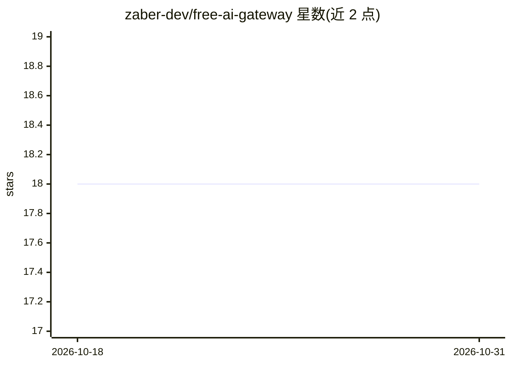

# zaber-dev/free-ai-gateway

⭐ 18 · TypeScript · MIT · 推送 2026-09-21 · [GitHub](https://github.com/zaber-dev/free-ai-gateway) · [官网](https://www.npmjs.com/org/free-ai-gateway) · 个人维护

**聚合 19+ 免费层 AI 供应商的能力路由网关与 MCP 服务器**

TypeScript monorepo，核心为协议无关的能力路由器（CapabilityRouter）与 20 个供应商适配器，按请求能力（tool_calling、vision、embedding 等）自动选择可用免费供应商，含故障转移、熔断、配额跟踪与多 Key 轮换。交付形态包括 OpenAI 兼容的 Fastify HTTP 代理、MCP 服务器（供 Claude Desktop、Cursor 等 agent 调用）、npm 库嵌入、IDE 技能安装器与终端 CLI。供应商覆盖 Google AI Studio、Groq、Cohere、Ollama 本地等，需自行配置 API key。

## 筛选速览

| 维度 | 判定 | 备注 |
|---|---|---|
| AI 角色 | `ai-ecosystem` | LLM/agent 周边工具 |
| 许可风险 | `permissive` | MIT |
| 部署形态 | `library` | 以包/库形式分发 |
| 模型依赖 | local-ok | 支持本地模型 |
| 硬件要求 | — | 无带数字的原话,不猜 |
| 安装摩擦 | `low` | 无编译、无系统依赖或容器化 |
| 成熟度 | — | 结构信号不足 |

## 能力要点

- 能力声明式路由与可插拔负载均衡策略
- 自动故障转移、熔断与 RPM/TPM/RPD 配额跟踪
- OpenAI 兼容 HTTP 代理 + MCP 服务器 + CLI + npm 库多种交付形态
- 20 个供应商适配器，含 Ollama 本地运行时

## 适用场景

- 把多个免费层 AI API 聚合为一个 OpenAI 兼容端点
- 为 Claude Desktop/Cursor 提供 MCP 工具调用免费模型
- 在终端通过 npx 直接以自然语言调用自动路由的模型

## 场景标签

`模型网关` · 领域:Agent 开发

## 证据(README 行号)

> L19: **`free-ai-gateway`** is organized as an enterprise monorepo separating **pure AI orchestration infrastructure** fr
> L36: |**`@free-ai-gateway/gateway`**|`apps/gateway`|High-throughput Fastify HTTP proxy serving OpenAI-compatible endpoin
> L42: - 🎯 **Capability-Based Routing**: Request what you need (`model: "auto:tool_calling+structured_output"`), and let t

## 星数曲线

2026-10-18 18 → 2026-10-31 18（+0）

---
*卡片 v1 · prompt 1.4 · 生成 2026-10-29 · 置信度 high · 依据 README sha `bcc7fdf1c0c5` · [字段定义](../../DATASET.md)*
