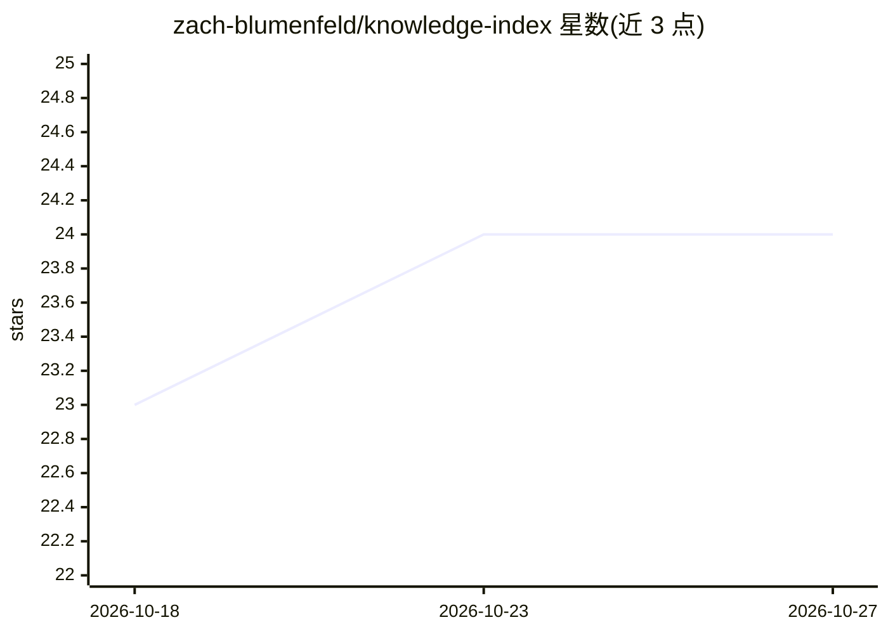

# zach-blumenfeld/knowledge-index

⭐ 24 · Python · Apache-2.0 · 推送 2026-08-25 · [GitHub](https://github.com/zach-blumenfeld/knowledge-index) · 个人维护

**Markdown 知识库的图索引搜索引擎，供 CLI 与 AI agent 检索**

将 Markdown 文件夹同步到 Neo4j 知识图谱索引的命令行工具，提供 outline/search/get 命令，供人类或编码 agent 在无先验知识情况下浏览与检索。索引时无 LLM 调用与嵌入，搜索为全文排序，索引为可重建的临时缓存，不修改源文件。通过 ki skill install 向检测到的编码 agent 注入 knowledge-base 技能，使其知道何时调用 ki。限制：仅支持 Markdown、暂无向量搜索、无 MCP 服务器、配置文件中为明文密码。

## 筛选速览

| 维度 | 判定 | 备注 |
|---|---|---|
| AI 角色 | `ai-ecosystem` | LLM/agent 周边工具 |
| 许可风险 | `permissive` | Apache-2.0 |
| 部署形态 | `None` |  |
| 模型依赖 | — | README 未给出锁定关系 |
| 硬件要求 | — | 无带数字的原话,不猜 |
| 安装摩擦 | `low` | 无编译、无系统依赖或容器化 |
| 成熟度 | — | 结构信号不足 |

## 能力要点

- 同步 Markdown 文件夹到 Neo4j 图索引，索引时无 LLM 与嵌入
- outline/search/get 等 CLI 命令，供人类与 AI agent 调用
- ki skill install 向检测到的编码 agent 注入调用技能
- 支持本地单库、远程只读库与跨库搜索三种模式

## 适用场景

- 给 Obsidian 库、git 仓库或研究文件夹建可检索索引
- 让编码 agent 通过 CLI 检索我的笔记与文档
- 跨多个知识库查询相关资料

## 场景标签

 · 领域:知识管理/开发工具

## 证据(README 行号)

> L4: Point `ki` at a folder of markdown — notes, docs, a wiki — and it syncs to a Neo4j knowledge-graph index you can sea
> L29: ## With an AI agent
> L31: Coding agents (Claude Code, Cursor, Windsurf, …) shell out to `ki` directly. `ki skill install` drops the bundled *

## 星数曲线

2026-10-18 23 → 2026-10-27 24（+1）

---
*卡片 v1 · prompt 1.4 · 生成 2026-10-27 · 置信度 high · 依据 README sha `fbf39a95f738` · [字段定义](../../DATASET.md)*
