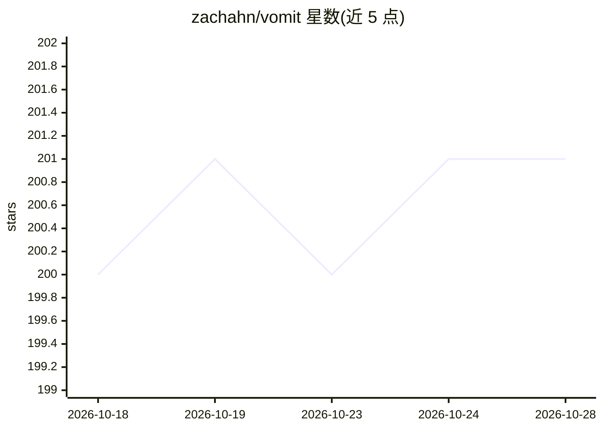

# zachahn/vomit

⭐ 201 · Go · GPL-3.0 · 推送 2026-09-09 · [GitHub](https://github.com/zachahn/vomit) · 个人维护

**把 Claude Code 的 token 输出经本地 LLM 改写为可读英文**

钩入 Claude Code 的终端 UI，将其原始 token 输出通过本地 LLM 转写为英文，完全本地运行、无遥测、无外部依赖；终端内可按 ctrl-o 切回原始输出。需自备本地 LLM（Llama.app、Ollama、Apfel 或任何 OpenAI API 兼容服务），通过 go install 安装二进制并运行 init 子命令配置。作者声明：本地 LLM 仅能看到 Claude 的通信内容、可能产生幻觉；仅在 Mac 上测试过，且运行较慢；旁挂模式（list/tail 子命令）已标记废弃。GPLv3 许可。

## 筛选速览

| 维度 | 判定 | 备注 |
|---|---|---|
| AI 角色 | `ai-ecosystem` | LLM/agent 周边工具 |
| 许可风险 | `viral` | GPL-3.0 |
| 部署形态 | `library` | 以包/库形式分发 |
| 模型依赖 | local-ok | 支持本地模型 |
| 硬件要求 | — | 无带数字的原话,不猜 |
| 安装摩擦 | `low` | 无编译、无系统依赖或容器化 |
| 成熟度 | `idea` | |

## 能力要点

- 钩入 Claude Code 终端 UI 改写输出，ctrl-o 可切回原文
- 完全本地运行、无遥测、无外部依赖
- 支持 Llama.app / Ollama / Apfel / OpenAI API 兼容的本地 LLM

## 适用场景

- 看不懂 Claude Code 原始 token 输出时获得可读版本
- 在本地 LLM 辅助下阅读 Claude 的流式输出以节省理解成本

## 场景标签

 · 领域:AI 开发者工具

## 证据(README 行号)

> L3: Vomit converts Claude's token vomit into English by piping it through a local LLM. It's fully local (no telemetry) a
> L5: Vomit hooks into Claude Code, rewriting all its output within the Claude Code terminal UI.

## 星数曲线

2026-10-18 200 → 2026-10-28 201（+1）

---
*卡片 v1 · prompt 1.4 · 生成 2026-10-22 · 置信度 high · 依据 README sha `c83933ce344d` · [字段定义](../../DATASET.md)*
