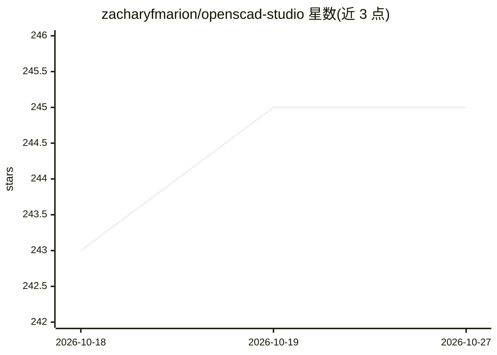

# zacharyfmarion/openscad-studio

⭐ 245 · TypeScript · GPL-2.0 · 推送 2026-08-19 · [GitHub](https://github.com/zacharyfmarion/openscad-studio) · [官网](https://openscad-studio.pages.dev/) · 个人维护

**带 AI 助手的 OpenSCAD 代码编辑器（Web 与 macOS）**

面向 OpenSCAD（程序化 2D/3D CAD 建模语言）的现代编辑器：提供多文件项目、Monaco 编辑、实时诊断、交互式 3D 预览、2D SVG 视图、参数自定义面板与分享链接。AI 部分：应用内聊天接流式响应，可选 Claude、GPT 或 OpenAI 兼容本地模型（Ollama、llama.cpp、LM Studio）生成/解释/修复 OpenSCAD 代码；桌面版暴露 localhost MCP 服务器供 Claude Code 等外部 agent 操作工作区。Web 版经 WebAssembly 在浏览器内渲染，桌面版捆绑原生 OpenSCAD 二进制，需 macOS 10.15+；已知预览尚不支持特殊操作符。

## 筛选速览

| 维度 | 判定 | 备注 |
|---|---|---|
| AI 角色 | `ai-enhanced` | 去掉 AI 部分产品仍成立 |
| 许可风险 | `viral` | GPL-2.0 |
| 部署形态 | `None` |  |
| 模型依赖 | local-ok | 支持本地模型 |
| 硬件要求 | — | 无带数字的原话,不猜 |
| 安装摩擦 | `low` | 无编译、无系统依赖或容器化 |
| 成熟度 | — | 结构信号不足 |

## 能力要点

- 多文件项目与来自 OpenSCAD 编译器的实时诊断
- 交互式 3D 预览、2D SVG 视图与测量工具
- AI 聊天支持 Claude/GPT 及 Ollama、llama.cpp、LM Studio 等本地模型
- 桌面版 MCP 服务器供外部 agent 渲染模型与编辑文件

## 适用场景

- 用现代化 IDE 体验编写 OpenSCAD 参数化模型
- 让 AI 助手生成、解释或修复 OpenSCAD 代码
- 激光切割/雕刻工作流中预览 2D 输出
- 通过浏览器免安装体验并分享可再混排的模型示例

## 场景标签

`AI 助手` · 领域:对话与助手

## 证据(README 行号)

> L21: OpenSCAD Studio is a professional editor for OpenSCAD — the programmable solid 3D and 2D CAD modeler. It replaces t
> L40: - **In-app chat** — Stream responses from Claude, GPT, or local OpenAI-compatible models such as Ollama, llama.cpp,

## 星数曲线

2026-10-18 243 → 2026-10-27 245（+2）

---
*卡片 v1 · prompt 1.4 · 生成 2026-10-22 · 置信度 high · 依据 README sha `a2a8ac4d0536` · [字段定义](../../DATASET.md)*
