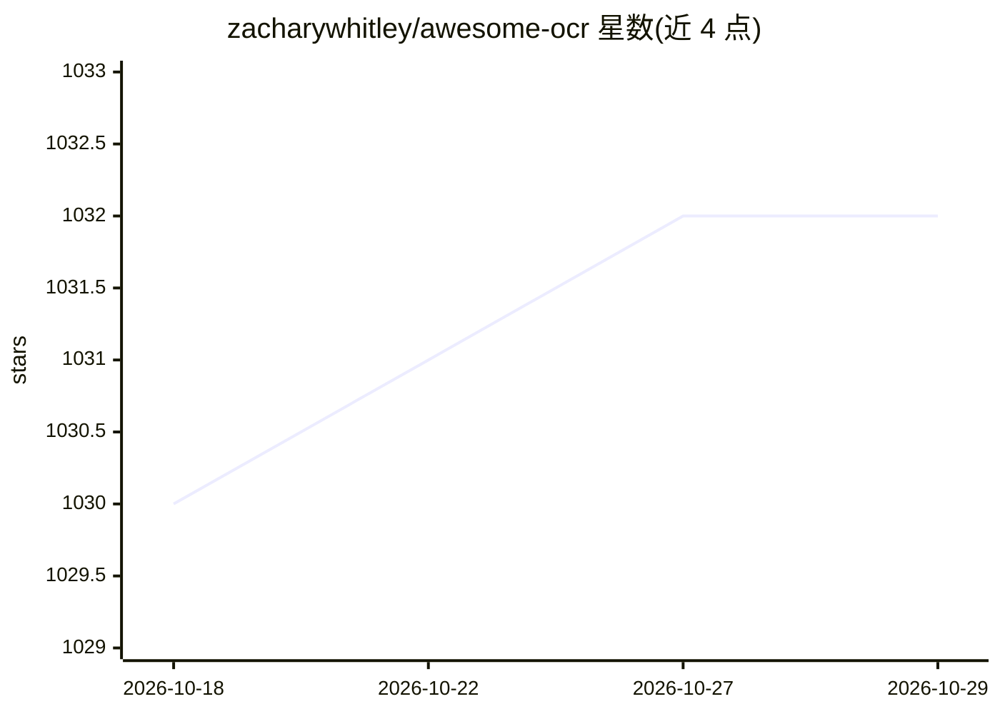

# zacharywhitley/awesome-ocr

⭐ 1,032 · 推送 2026-08-13 · [GitHub](https://github.com/zacharywhitley/awesome-ocr) · 个人维护

**OCR 相关算法与工具的策展清单（检测/矫正/分割等）**

一个 awesome 类型的 OCR 资源清单，按处理环节组织条目：文档去偏与去扭曲（Deskewing/Dewarping）、行/字符/词/文档版面分割、手写文本识别、表格检测、语言检测、文本检测与定位（含 ABCNet/CRAFT/FOTS/TextBoxes++/PSENet/EAST 等按论文归类的系列实现）。条目多为 GitHub 仓库链接并附论文年份或一句话说明，供开发者按任务环节查找 OCR 相关的实现与研究代码。清单本身不含代码，不提供安装运行方式。

## 筛选速览

| 维度 | 判定 | 备注 |
|---|---|---|
| AI 角色 | `ai-knowledge` | 知识聚合/清单类 |
| 许可风险 | `none` | — |
| 部署形态 | `None` |  |
| 模型依赖 | — | README 未给出锁定关系 |
| 硬件要求 | — | 无带数字的原话,不猜 |
| 安装摩擦 | `low` | 无编译、无系统依赖或容器化 |
| 成熟度 | — | 结构信号不足 |

## 能力要点

- 按 OCR 处理流水线环节分类组织条目
- 收录场景文本检测/识别论文的官方与复现实现
- 含手写识别、表格检测、版面分析、去偏矫正等子方向

## 适用场景

- 为 OCR 项目按环节（矫正/分割/检测/识别）查找可用的开源实现
- 追溯场景文本检测论文（CRAFT、FOTS、EAST 等）对应的代码仓库
- 了解手写识别与表格提取方向的工具分布

## 场景标签

`精选清单` `OCR` · 领域:学习与行业

## 证据(README 行号)

> L1: # Awesome OCR
> L3: ## Deskewing and Dewarping
> L26: ## Segmentation
> L104: ## Text detection and localization

## 星数曲线

2026-10-18 1,030 → 2026-10-29 1,032（+2）

---
*卡片 v1 · prompt 1.4 · 生成 2026-10-21 · 置信度 high · 依据 README sha `715cef5b9864` · [字段定义](../../DATASET.md)*
