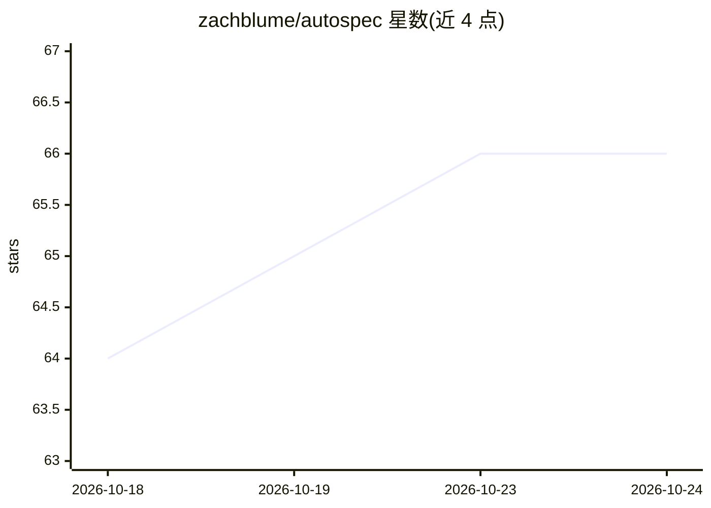

# zachblume/autospec

⭐ 67 · TypeScript · MIT · 推送 2026-05-15 · [GitHub](https://github.com/zachblume/autospec) · [官网](https://autospec.dev) · 个人维护

**AI 代理：给定 Web 应用 URL，自主探索并生成 Playwright E2E 测试**

面向 Web 应用的端到端测试生成 CLI 工具：给定 URL 与模型 API key，代理爬取最多 3 个页面、读取无障碍快照，用视觉与语言模型生成常识性测试规范并在隔离浏览器上下文中并行执行，通过语义化操作（按角色点击、按标签填写）模拟真实用户判断行为是否正确。通过的测试以标准 Playwright .spec.js 文件（使用 getByRole 等定位 API）保存到 trajectories/ 目录，附视频与截图，可随时用 npx playwright test 重跑。无需配置，需 Node.js >= 22 与受支持模型的 API key。

## 筛选速览

| 维度 | 判定 | 备注 |
|---|---|---|
| AI 角色 | `ai-native` | 本体是模型或模型工具 |
| 许可风险 | `permissive` | MIT |
| 部署形态 | `library` | 以包/库形式分发 |
| 模型依赖 | — | README 未给出锁定关系 |
| 硬件要求 | — | 无带数字的原话,不猜 |
| 安装摩擦 | `low` | 无编译、无系统依赖或容器化 |
| 成熟度 | — | 结构信号不足 |

## 能力要点

- 代理自主探索页面并生成常识性测试规范，而非基于历史行为的回归比对
- 通过的测试导出为标准 Playwright .spec.js 文件，附视频与截图
- 每个 spec 在独立隔离浏览器上下文并行执行，每步后重读无障碍快照
- 零配置：指向 URL 即可运行

## 适用场景

- 新功能实现后立即生成可重跑的 E2E 测试
- 没有既有测试脚本的 Web 应用快速建立测试覆盖
- 以自然常识判断 UI 行为是否符合预期而非固化回归基线

## 场景标签

`浏览器自动化` · 领域:效率与自动化

## 证据(README 行号)

> L5: Autospec is an AI agent that autonomously explores your web application,
> L7: reusable Playwright test files. It uses vision and language models to mimic
> L64: 3. **Report** — Prints a pass/fail summary and writes Playwright `.spec.js`

## 星数曲线

2026-10-18 64 → 2026-10-24 66（+2）

---
*卡片 v1 · prompt 1.4 · 生成 2026-10-24 · 置信度 high · 依据 README sha `d0afa6236131` · [字段定义](../../DATASET.md)*
