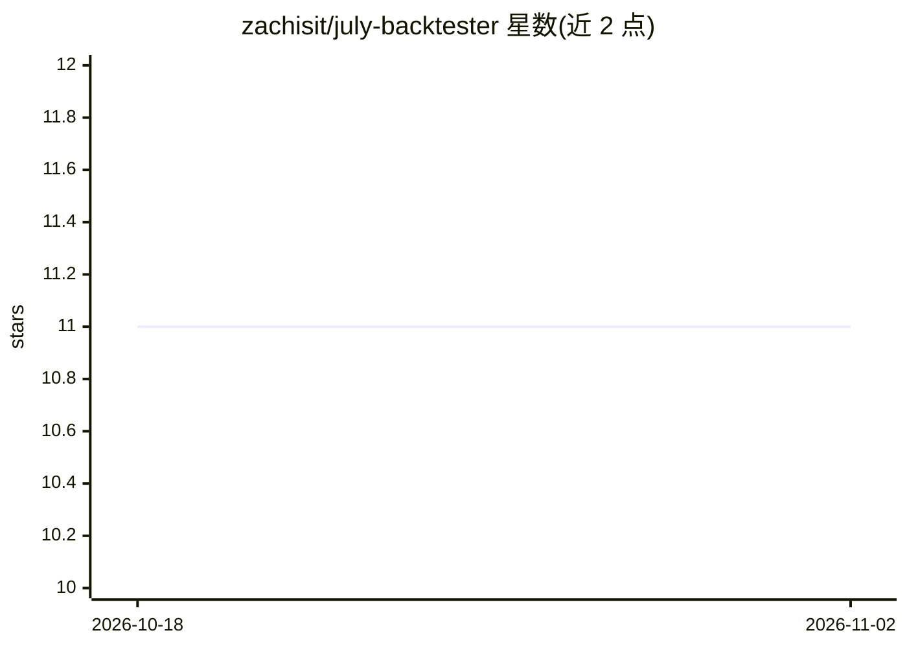

# zachisit/july-backtester

⭐ 11 · Python · MIT · 推送 2026-10-24 · [GitHub](https://github.com/zachisit/july-backtester) · 个人维护

**美股策略回测引擎：蒙特卡洛与前向分析压力测试**

Python 编写的美股股票策略回测引擎（Python 3.10+，MIT 许可）。以 1,000 路径蒙特卡洛模拟与前向分析（WFA）区分真实优势与过拟合，支持 Point-in-Time 无幸存者偏差的 S&P 500/Nasdaq 100 成分股回溯、日内多周期 K 线、高级仓位管理与数据质量校验，输出 Sharpe/Calmar 等指标、PDF 报告与机器可读的 llm_verdict.json。策略以装饰器注册、自动发现；支持 Polygon/Norgate/Yahoo/本地 CSV 与 Parquet 五种数据源，Yahoo 免 API key。仓库自身不含市场数据。

## 筛选速览

| 维度 | 判定 | 备注 |
|---|---|---|
| AI 角色 | `ai-enhanced` | 去掉 AI 部分产品仍成立 |
| 许可风险 | `permissive` | MIT |
| 部署形态 | `library` | 以包/库形式分发 |
| 模型依赖 | — | README 未给出锁定关系 |
| 硬件要求 | — | 无带数字的原话,不猜 |
| 安装摩擦 | `low` | 无编译、无系统依赖或容器化 |
| 成熟度 | — | 结构信号不足 |

## 能力要点

- 1,000 路径蒙特卡洛 + 前向分析验证策略稳健性
- Point-in-time 无幸存者偏差的 S&P 500 / Nasdaq 100 历史成分回测
- 支持 Polygon/Norgate/Yahoo/本地 CSV/Parquet 五种数据源，Yahoo 免 API key
- 输出 PDF 报告与机器可读的 llm_verdict.json，含研究索引汇总脚本

## 适用场景

- 验证我的交易策略是否在蒙特卡洛与前向分析下仍然有效
- 用历史成分股名单做无幸存者偏差的指数组合回测
- 对比多次调参运行的结果并生成汇总研究索引

## 场景标签

`金融量化` · 领域:学习与行业

## 证据(README 行号)

> L9: Tests trading strategies against full historical US equity data, runs 1,000-path Monte Carlo simulation and Walk-For
> L218: Every run writes `output/runs/<run_id>/llm_verdict.json` — a machine-readable file designed to let an LLM, script,

## 星数曲线

2026-10-18 11 → 2026-11-02 11（+0）

---
*卡片 v1 · prompt 1.4 · 生成 2026-11-01 · 置信度 low · 依据 README sha `f6bde43e5b2d` · [字段定义](../../DATASET.md)*
