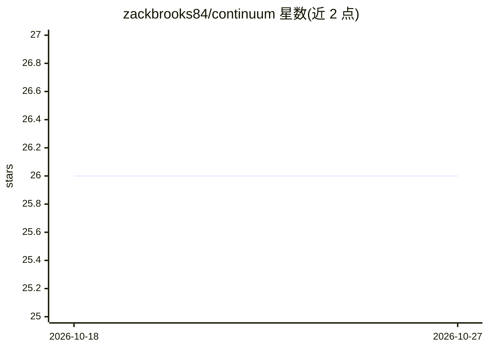

# zackbrooks84/continuum

⭐ 26 · Python · MIT · 推送 2026-04-13 · [GitHub](https://github.com/zackbrooks84/continuum) · 个人维护

**AI agent 的异步任务队列与跨会话持久记忆工具**

面向 Claude Code 等 AI agent 使用者的 Python 工具（3.11+），由 SQLite 单库存储、后台 daemon 执行任务与观测压缩、MCP server 暴露 40+ 工具构成。提供跨会话持久记忆（checkpoint、FTS5 三层检索、smart_resume）、后台任务队列与自动检查点、Token 预算监控、Telegram/Discord/Slack 通知、面向 ChatGPT/Gemini 的跨 agent 交接导出。通过 Tailscale Funnel 远程服务器将本地 DB 桥接到 Claude.ai Web。安装支持 setup 脚本或 pip 从 GitHub 安装；无云账号、无 API key 要求，数据留在本机。

## 筛选速览

| 维度 | 判定 | 备注 |
|---|---|---|
| AI 角色 | `ai-ecosystem` | LLM/agent 周边工具 |
| 许可风险 | `permissive` | MIT |
| 部署形态 | `library` | 以包/库形式分发 |
| 模型依赖 | locked-api |  |
| 硬件要求 | — | 无带数字的原话,不猜 |
| 安装摩擦 | `low` | 无编译、无系统依赖或容器化 |
| 成熟度 | — | 结构信号不足 |

## 能力要点

- SQLite + FTS5 的三层记忆检索（smart_resume 自动深度选择）
- 后台 daemon 执行任务并自动压缩观测为 checkpoint
- MCP server 暴露 40+ 工具，支持 Claude Code 与 Claude.ai Custom Connectors
- Token Guard 在上下文预算 80% 时自动 checkpoint

## 适用场景

- 让 Claude Code 每次会话自动恢复项目上下文，不用重复解释
- 把长时间运行的任务放到后台执行并自动保存结果
- 把本地记忆通过远程服务器接入 Claude.ai Web 使用

## 场景标签

 · 领域:LLM 基础设施/agent 工具

## 证据(README 行号)

> L85: ## MCP Setup (Claude Code)
> L105: Restart Claude Code. All 40+ tools load automatically.
> L240: One SQLite database at `~/.continuum/continuum.db`. A background daemon handles task execution, observation compre

## 星数曲线

2026-10-18 26 → 2026-10-27 26（+0）

---
*卡片 v1 · prompt 1.4 · 生成 2026-10-26 · 置信度 high · 依据 README sha `81b95df80b49` · [字段定义](../../DATASET.md)*
