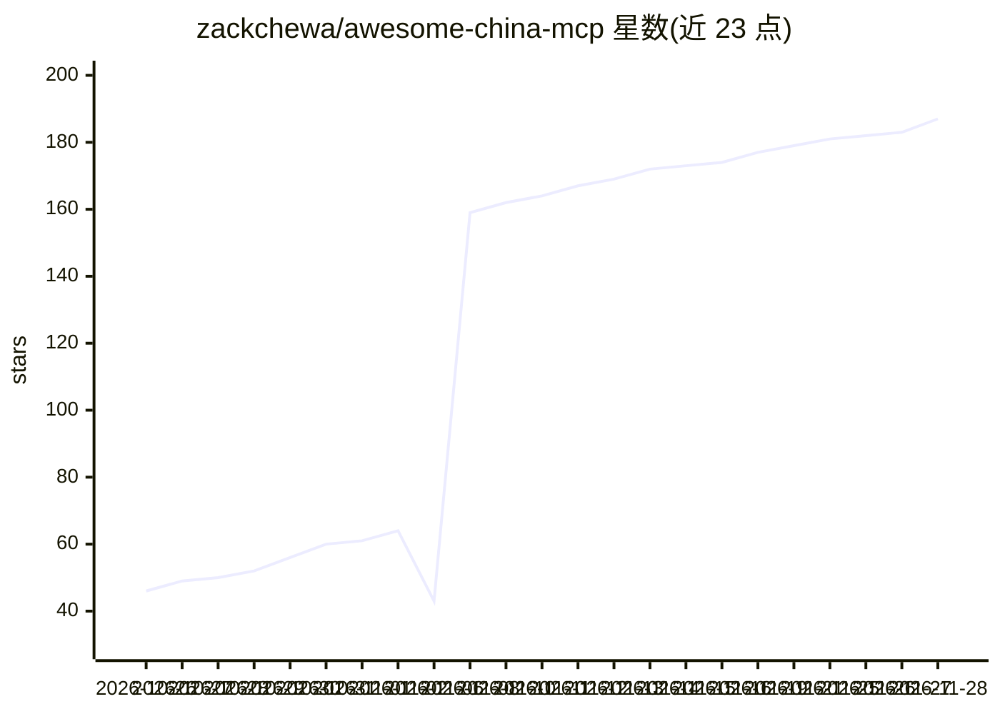

# zackchewa/awesome-china-mcp

⭐ 187 · CC0-1.0 · 推送 2026-11-14 · [GitHub](https://github.com/zackchewa/awesome-china-mcp) · 个人维护 · 中文 README

**连接中国应用的 MCP Server 策展索引：让 AI Agent 调用国内服务**

收录可连接中国应用与服务的 Model Context Protocol 服务器索引，覆盖云服务、地图出行、支付、内容社交、电商、生活服务、办公协作等类别，优先收录官方服务器，并标注认证方式（API Key/OAuth/Cookie 等）与社区 star 数。附有 gap map 记录尚无官方 MCP 的服务，同时区分 MCP Server、Agent Skill 与 API 三种接入形态。使用方式为在 MCP 兼容客户端中配置；多数平台 API 需自备凭证，部分需企业认证。

## 筛选速览

| 维度 | 判定 | 备注 |
|---|---|---|
| AI 角色 | `ai-knowledge` | 知识聚合/清单类 |
| 许可风险 | `viral` | CC0-1.0 |
| 部署形态 | `library` | 以包/库形式分发 |
| 模型依赖 | — | README 未给出锁定关系 |
| 硬件要求 | — | 无带数字的原话,不猜 |
| 安装摩擦 | `low` | 无编译、无系统依赖或容器化 |
| 成熟度 | — | 结构信号不足 |

## 能力要点

- 汇总覆盖云/地图/支付/社交/电商/办公等类别的中国应用 MCP Server
- 标注官方（🏢）与社区（👥）来源、GitHub star 与认证方式
- 附带 gap map：记录 78 个仅有官方 API 的服务
- 区分 MCP Server、Agent Skill 与 API 三种接入路径

## 适用场景

- 为 AI Agent 查找接入高德地图、12306、小红书等国内服务的 MCP 配置
- 对比同一服务的官方与社区 MCP 实现并选择接入方案
- 排查某国内服务是否已有官方 MCP 或仅有 API/Skill

## 场景标签

`精选清单` · 领域:学习与行业

## 证据(README 行号)

> L3: > The curated index of **Model Context Protocol (MCP) servers for Chinese apps & services** — give your AI agent the
> L17: 国外有 Composio 这样的「一个平台连上千个 app」。**国内没有对应的开源索引** —— 各家服务各自为政，MCP Server 散落各处。这个清单把它们汇总到一处，官方优先。

## 星数曲线

2026-10-26 46 → 2026-11-28 187（+141）

---
*卡片 v1 · prompt 1.4 · 生成 2026-11-26 · 置信度 mid · 依据 README sha `7541784173aa` · [字段定义](../../DATASET.md)*
