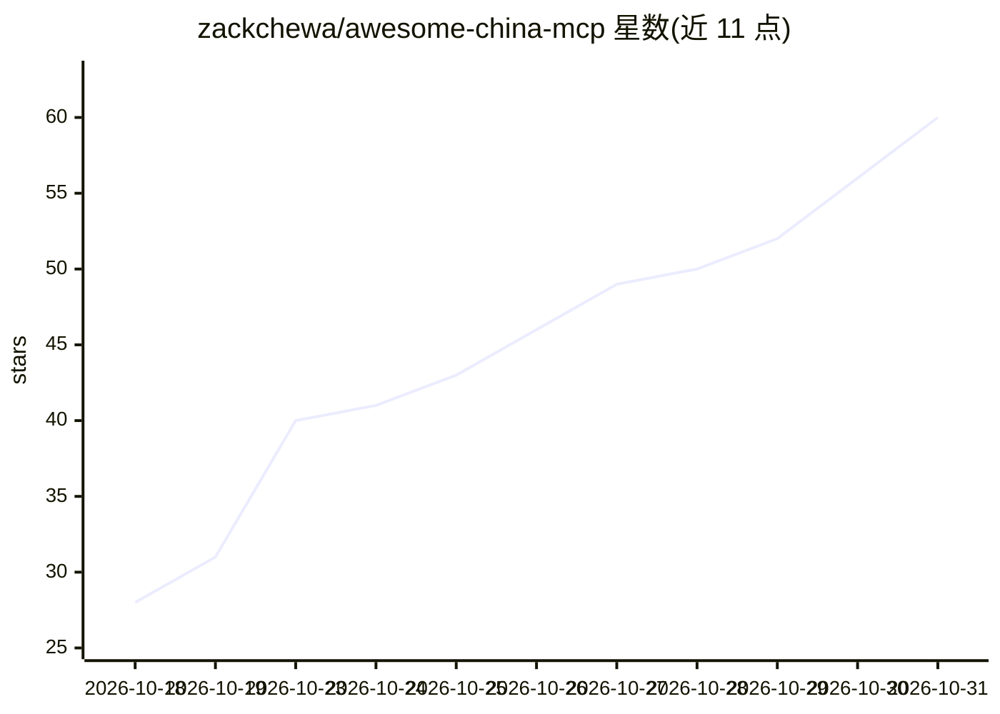

# zackchewa/awesome-china-mcp

⭐ 60 · CC0-1.0 · 推送 2026-10-28 · [GitHub](https://github.com/zackchewa/awesome-china-mcp) · 个人维护 · 中文 README

**面向中国应用与服务的 MCP Server 策展索引（官方优先）**

一个 awesome-list 形式的策展清单：汇总可连接中国互联网服务的 Model Context Protocol (MCP) 服务器，覆盖云基础设施、地图出行、支付、内容社交、电商、生活服务、办公协作与开发工具等类别，官方第一方服务优先标注。条目附 GitHub stars、语言、hosted/仓库区分与安全注意事项；另收录 78 个有官方 API 但尚无 MCP 的中国服务缺口地图。使用方式为将任意 MCP 客户端指向清单中的服务器，凭据需自备。

## 筛选速览

| 维度 | 判定 | 备注 |
|---|---|---|
| AI 角色 | `ai-knowledge` | 知识聚合/清单类 |
| 许可风险 | `viral` | CC0-1.0 |
| 部署形态 | `library` | 以包/库形式分发 |
| 模型依赖 | — | README 未给出锁定关系 |
| 硬件要求 | — | 无带数字的原话,不猜 |
| 安装摩擦 | `low` | 无编译、无系统依赖或容器化 |
| 成熟度 | — | 结构信号不足 |

## 能力要点

- 按云服务/地图/支付/社交/电商/办公等类别组织条目，官方优先标注
- 收录 78 个有官方 API 但尚无 MCP server 的中国服务缺口地图
- 条目附安全注意事项（凭据泄露、越权读写等风险提示）
- 条目链接与归档状态定期核查（README 标注 2026-10-10 更新）

## 适用场景

- 给我的 AI Agent 找可调用高德/12306/飞书等国内服务的 MCP server
- 查某个中国应用有没有官方 MCP 及替代的社区实现
- 从缺口地图里挑一个没有 MCP 的服务来开发

## 场景标签

`精选清单` · 领域:学习与行业

## 证据(README 行号)

> L3: > The curated index of **Model Context Protocol (MCP) servers for Chinese apps & services** — give your AI agent the
> L15: In the West, Composio, Nango and friends give an AI agent one place to connect 1000+ apps. **There is no open-sourc
> L34: > 🧩 **Also in here:** a gap map of 78 Chinese services that have an official API but **no MCP server yet** — pick o

## 星数曲线

2026-10-18 28 → 2026-10-31 60（+32）

---
*卡片 v1 · prompt 1.4 · 生成 2026-10-25 · 置信度 mid · 依据 README sha `8b87c8783a1a` · [字段定义](../../DATASET.md)*
