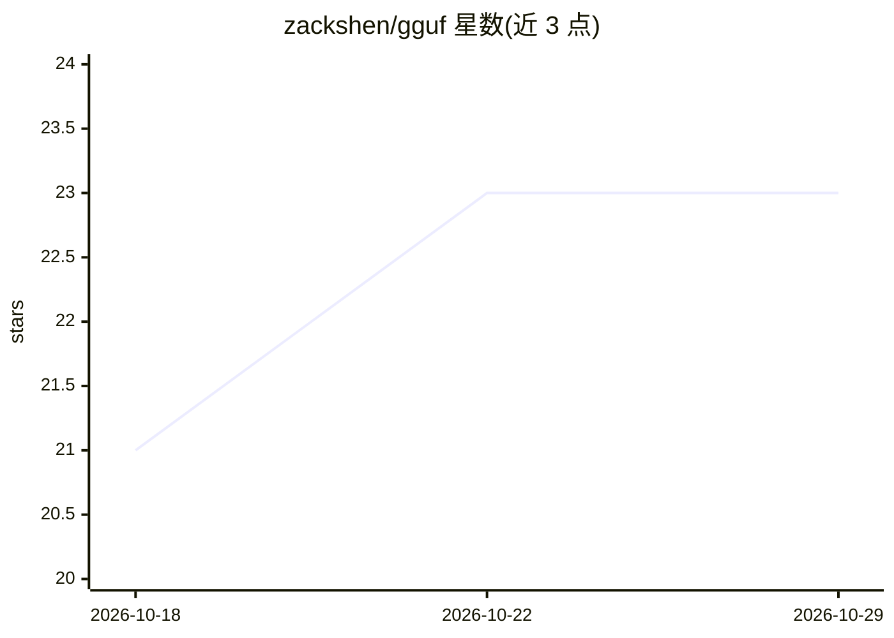

# zackshen/gguf

⭐ 23 · Rust · MIT · 推送 2026-08-31 · [GitHub](https://github.com/zackshen/gguf) · [官网](https://github.com/zackshen/gguf) · 个人维护

**Rust 开发者用的 GGUF 模型文件解析与写入库**

以 Rust 库形式提供 GGUF（GGML 通用格式）文件的解析与读写能力：解码 v1/v2/v3 版本文件，读取键值元数据与张量信息，支持大小端字节序，实现零拷贝元数据访问、惰性张量数据加载；可选 mmap 特性用于多 GB 大文件的高效访问，可选 async 特性支持异步 I/O，另提供写入 GGUF 文件的 API。附带 CLI 工具可快速查看模型元数据与张量列表，支持 F32/BF16/Q 系列与 IQ 系列等量化类型。

## 筛选速览

| 维度 | 判定 | 备注 |
|---|---|---|
| AI 角色 | `ai-ecosystem` | LLM/agent 周边工具 |
| 许可风险 | `permissive` | MIT |
| 部署形态 | `library` | 以包/库形式分发 |
| 模型依赖 | — | README 未给出锁定关系 |
| 硬件要求 | — | 无带数字的原话,不猜 |
| 安装摩擦 | `low` | 无编译、无系统依赖或容器化 |
| 成熟度 | — | 结构信号不足 |

## 能力要点

- 解析 GGUF v1/v2/v3 文件，读取键值元数据与张量信息
- 零拷贝元数据访问与惰性张量加载，元数据数组默认截断为 3 个元素
- 可选 mmap（大文件）与 async（异步 I/O）特性
- 支持写入 GGUF 文件，并附带 CLI 检查工具

## 适用场景

- 在 Rust 项目中读取 GGUF 量化模型的元数据与张量结构
- 快速检查本地 GGUF 模型文件的内容
- 构建需要异步读取或内存映射大模型文件的工具

## 场景标签

 · 领域:LLM 基础设施/文件格式解析

## 证据(README 行号)

> L11: A Rust library for parsing and reading GGUF (GGML Universal Format) files. GGUF files are binary files that contain
> L15: - ✅ Decode GGUF files (v1, v2, v3)

## 星数曲线

2026-10-18 21 → 2026-10-29 23（+2）

---
*卡片 v1 · prompt 1.4 · 生成 2026-10-27 · 置信度 high · 依据 README sha `7365f35a6453` · [字段定义](../../DATASET.md)*
