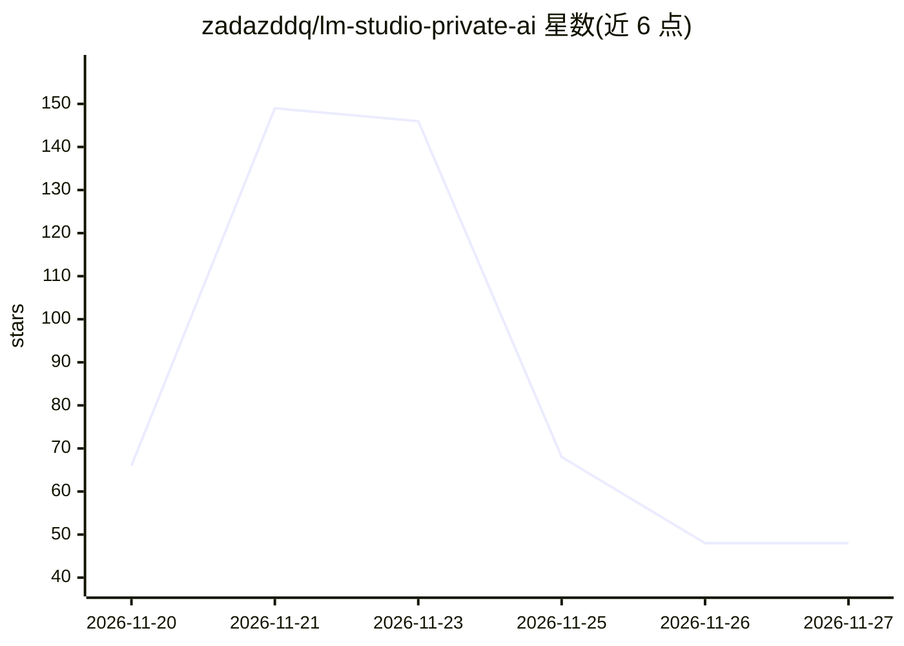

# zadazddq/lm-studio-private-ai

⭐ 48 · Rust · 推送 2026-11-26 · [GitHub](https://github.com/zadazddq/lm-studio-private-ai) · 个人维护

**本地运行大语言模型的桌面软件，数据不出本机**

面向需要在本地运行大语言模型的技术用户，提供桌面版推理环境：加载 GGUF 等量化模型文件，支持 CPU/GPU 分层推理、可配置上下文与采样参数。内置多轮对话界面、OpenAI 兼容的本地 HTTP 接口（chat completions/completions）、模型库管理（导入/组织/切换模型并查看元数据）、参数预设、JSON schema 与语法约束的结构化输出、令牌用量统计，以及默认关闭遥测的隐私设置；模型就位后可完全离线运行。

## 筛选速览

| 维度 | 判定 | 备注 |
|---|---|---|
| AI 角色 | `ai-ecosystem` | LLM/agent 周边工具 |
| 许可风险 | `none` | — |
| 部署形态 | `None` |  |
| 模型依赖 | — | README 未给出锁定关系 |
| 硬件要求 | — | 无带数字的原话,不猜 |
| 安装摩擦 | `medium` | 含编译或系统依赖之一 |
| 成熟度 | — | 结构信号不足 |

## 能力要点

- 本地推理引擎，执行阶段无网络依赖，数据不离开主机
- OpenAI 兼容本地 HTTP 接口，现有客户端库可无改动对接
- 加载 GGUF 及兼容量化格式，支持 GPU 分层卸载与 CPU 回退
- JSON schema 约束与语法采样等结构化输出控制

## 适用场景

- 在笔记本上本地总结涉密访谈记录，材料不出设备
- 基于本地参考文档起草回复并复用保存的参数预设
- 在小内存机器上依据资源监控切换更小的模型

## 场景标签

`推理引擎` `聊天机器人` `AI 助手` · 领域:对话与助手

## 证据(README 行号)

> L12: LM Studio is a desktop application for running local large language models with complete data privacy. It provides 
> L26: - **OpenAI-compatible local server:** Exposes a local HTTP endpoint implementing the chat completions and completio

## 星数曲线

2026-11-20 66 → 2026-11-27 48（-18）

---
*卡片 v1 · prompt 1.4 · 生成 2026-11-20 · 置信度 high · 依据 README sha `1fe5abe8e45a` · [字段定义](../../DATASET.md)*
