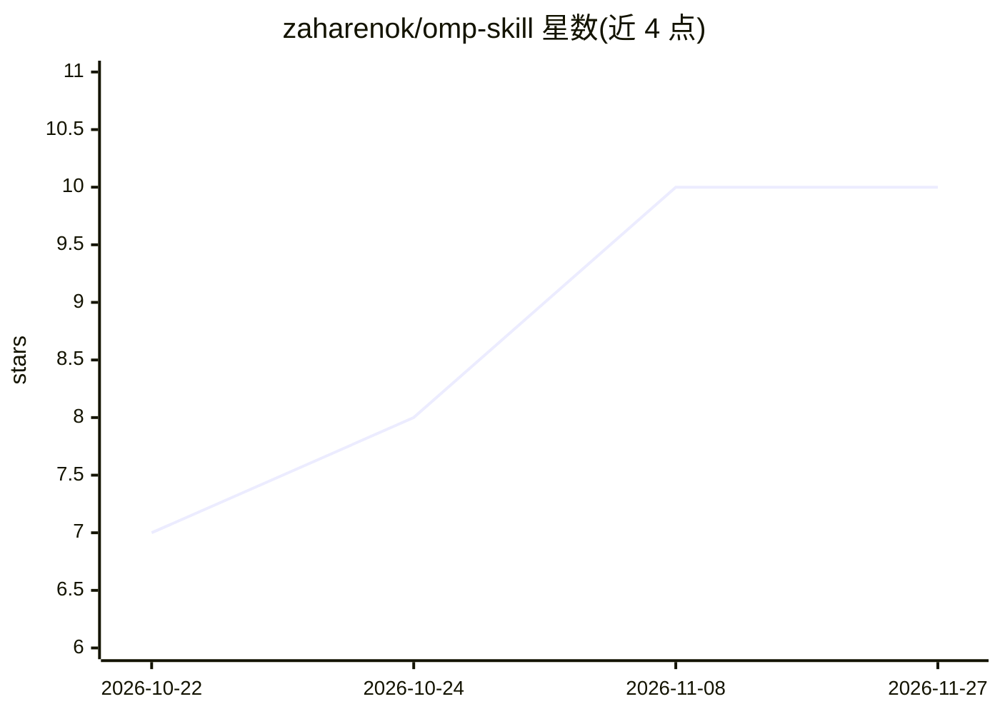

# zaharenok/omp-skill

⭐ 10 · Shell · MIT · 推送 2026-09-14 · [GitHub](https://github.com/zaharenok/omp-skill) · 个人维护

**教任意 AI agent 驱动 omp 终端编码代理的技能手册**

以 SKILL.md + Markdown 参考文档形式提供的技能包，内容为驱动 omp（终端编码代理）的 headless 用法知识：一次性执行、会话续接、NDJSON 事件解析、计划模式、子代理调度、只读工具锁定与模型路由等。安装脚本自动检测已装的 agent 并写入各自 skills 目录，安装时不执行代码。要求本机已安装 omp 且至少一个 provider 已认证。支持 Hermes、Claude Code、Codex、OpenCode 等目录布局，已在 macOS 上对 omp 18.1.18 验证。

## 筛选速览

| 维度 | 判定 | 备注 |
|---|---|---|
| AI 角色 | `ai-knowledge` | 知识聚合/清单类 |
| 许可风险 | `permissive` | MIT |
| 部署形态 | `None` |  |
| 模型依赖 | — | README 未给出锁定关系 |
| 硬件要求 | — | 无带数字的原话,不猜 |
| 安装摩擦 | `low` | 无编译、无系统依赖或容器化 |
| 成熟度 | — | 结构信号不足 |

## 能力要点

- 纯 Markdown 技能包，安装时不执行任何代码
- 覆盖 omp 的 headless 模式：-p 一次性执行、-c 会话续接、--mode json 事件解析
- 提供面向 Hermes/Claude Code/Codex/OpenCode 等 6 类目录的安装脚本
- 附完整 CLI 标志与能力参考文档

## 适用场景

- 让已有 agent 通过 omp 获得 LSP 重命名与 DAP 调试能力
- 为使用 omp 的开发者沉淀标准 headless 调用模式
- 在多个 agent 间共享同一套 omp 驱动知识

## 场景标签

`编码 Agent` · 领域:编码与开发

## 证据(README 行号)

> L5: **Teach your AI agent to drive omp — the terminal coding agent with LSP code intelligence, live debugging, plan mode
> L35: ├── SKILL.md                      # the playbook your agent loads on demand
> L64: Requires omp installed and at least one provider authenticated (`omp models` to check).

## 星数曲线

2026-10-22 7 → 2026-11-27 10（+3）

---
*卡片 v1 · prompt 1.4 · 生成 2026-11-19 · 置信度 high · 依据 README sha `58ae0da1249f` · [字段定义](../../DATASET.md)*
