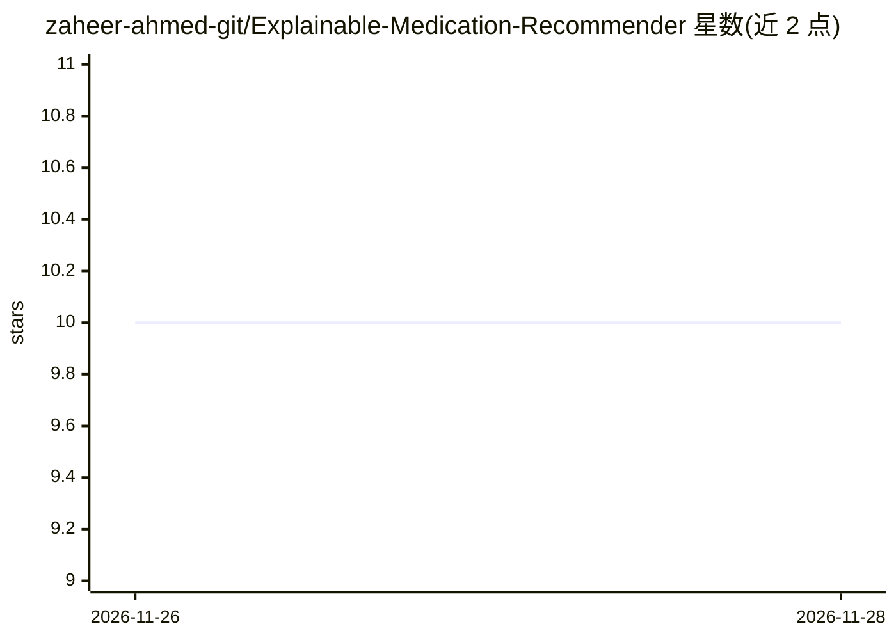

# zaheer-ahmed-git/Explainable-Medication-Recommender

⭐ 10 · Python · NOASSERTION · 推送 2026-11-26 · [GitHub](https://github.com/zaheer-ahmed-git/Explainable-Medication-Recommender) · 个人维护

**面向临床医生的可解释药物推荐研究流水线**

研究型软件，结合会话式临床理解、Transformer-GNN 混合排序与基于证据的解释，产出带理由、警告与审计追踪的 top-k 药物候选。系统分四层：LLM 抽取结构化患者画像、混合推荐模型、生成文本前组装归因与图证据、医生复核。基于 MIMIC-IV/eICU 等受保护数据，在 ULCO Calculco 集群以 Python 3.13 与 uv 运行。声明非医疗器械，不用于临床处方；临床输入适配器与图干预仍在规划中。

## 筛选速览

| 维度 | 判定 | 备注 |
|---|---|---|
| AI 角色 | `ai-native` | 本体是模型或模型工具 |
| 许可风险 | `none` | NOASSERTION |
| 部署形态 | `None` |  |
| 模型依赖 | — | README 未给出锁定关系 |
| 硬件要求 | — | 无带数字的原话,不猜 |
| 安装摩擦 | `low` | 无编译、无系统依赖或容器化 |
| 成熟度 | `idea` | |

## 能力要点

- Transformer 建模患者上下文与时间交互，异构 GNN 建模患者-诊断-药物-检验关系
- 生成文本前组装归因、图证据、临床规则、不确定性与溯源
- 配对五折 OOF 后期融合评估协议
- 通过 OAR 脚本向集群提交全量运行

## 适用场景

- 在 MIMIC-IV 等数据集上复现可解释药物推荐实验
- 研究临床推荐系统中的归因与溯源方法
- 按临床风格 top-k 指标评估排序与校准

## 场景标签

`推荐系统` `科研工具` · 领域:学习与行业

## 证据(README 行号)

> L3: Research software for a clinician-facing medication recommender that combines
> L29: 1. **Conversational understanding:** an LLM extracts a structured patient profile.
> L30: 2. **Hybrid recommendation:** a Transformer models patient-context and temporal

## 星数曲线

2026-11-26 10 → 2026-11-28 10（+0）

---
*卡片 v1 · prompt 1.4 · 生成 2026-11-26 · 置信度 high · 依据 README sha `defbc32b306d` · [字段定义](../../DATASET.md)*
