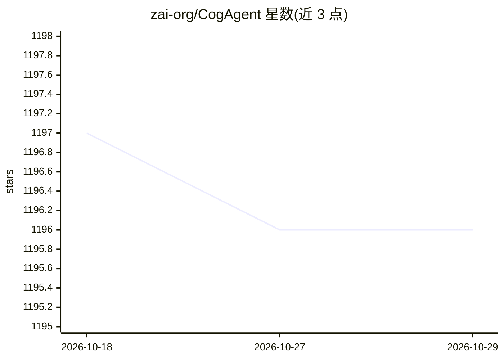

# zai-org/CogAgent

⭐ 1,196 · Python · Apache-2.0 · 推送 2026-10-12 · [GitHub](https://github.com/zai-org/CogAgent) · 组织维护 · 中文 README

**开源 VLM GUI Agent 模型：看屏幕截图执行跨平台界面操作**

CogAgent-9B-20241220 是基于 GLM-4V-9B 的双语（中英）视觉语言 GUI Agent 执行模型：接收屏幕截图与任务描述，输出带坐标的动作指令（点击/输入/滚动等），支持 Windows、macOS 与 Android 平台，可用于自动化图形界面操作。模型属执行型而非对话型，不支持连续对话但支持执行历史。BF16 推理需至少 29GB 显存，INT8 约 15GB，INT4 约 8GB（仅限 NVIDIA 设备）；SFT 微调需 8×A100 且冻结视觉编码器，LoRA 需单卡约 70GB 显存。已应用于智谱 GLM-PC 产品，CVPR 2024 Highlight 论文。

## 筛选速览

| 维度 | 判定 | 备注 |
|---|---|---|
| AI 角色 | `ai-native` | 本体是模型或模型工具 |
| 许可风险 | `permissive` | Apache-2.0 |
| 部署形态 | `library` | 以包/库形式分发 |
| 模型依赖 | — | README 未给出锁定关系 |
| 硬件要求 | `gpu-8g` | |
| 安装摩擦 | `low` | 无编译、无系统依赖或容器化 |
| 成熟度 | — | 结构信号不足 |

## 能力要点

- 截图+自然语言输入，输出带坐标的 GUI 动作指令（Action-Operation 格式）
- 支持 Windows 10/11、macOS 14/15、Android 13-15 三类平台
- 多种输出格式可选：含敏感操作标记、Status、Plan 等字段
- HuggingFace/ModelScope/Modelers(Ascend) 提供模型下载与在线 Demo

## 适用场景

- 让模型根据屏幕截图自动执行桌面或手机的 GUI 操作任务
- 研究基于视觉语言模型的 GUI Agent 与 GUI Grounding 基准
- 在自有数据上对 GUI Agent 模型做 SFT 或 LoRA 微调

## 场景标签

`GUI 自动化` · 领域:效率与自动化

## 证据(README 行号)

> L24: `CogAgent-9B-20241220` model is based on GLM-4V-9B, a bilingual open-source
> L77: `cogagent-9b-20241220` is an agent-type execution model rather than a conversational model. It does not support

## 星数曲线

2026-10-18 1,197 → 2026-10-29 1,196（-1）

---
*卡片 v1 · prompt 1.4 · 生成 2026-10-21 · 置信度 high · 依据 README sha `e096f7b6fbb1` · [字段定义](../../DATASET.md)*
