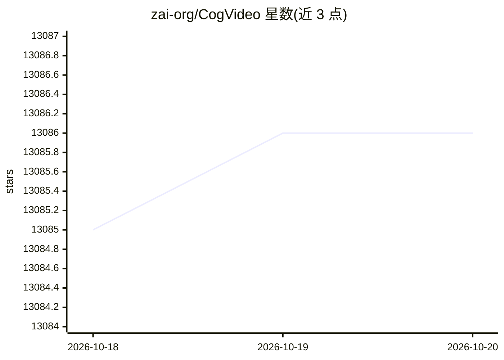

# zai-org/CogVideo

⭐ 13,086 · Python · Apache-2.0 · 推送 2025-11-04 · [GitHub](https://github.com/zai-org/CogVideo) · 组织维护 · 中文 README

**开源文生视频/图生视频大模型 CogVideoX 系列官方代码库**

智谱（QingYing/清影）开源的视频生成模型系列官方仓库，覆盖 CogVideoX1.5-5B、CogVideoX-5B、2B 及 I2V 图生视频版本，支持文生视频、视频续写、图生视频三类任务。提供 SAT 与 Diffusers 两套推理/微调代码，支持 TorchAO INT8/FP8 量化降低显存占用，可用 LoRA 微调，最低约 4GB 显存可运行 2B 模型（FP16 diffusers）。模型仅支持英文提示词，需 Python 3.10-3.12 与 NVIDIA GPU，FP8 需 H100 以上并推荐 CUDA 12.4。

## 筛选速览

| 维度 | 判定 | 备注 |
|---|---|---|
| AI 角色 | `ai-native` | 本体是模型或模型工具 |
| 许可风险 | `permissive` | Apache-2.0 |
| 部署形态 | `library` | 以包/库形式分发 |
| 模型依赖 | — | README 未给出锁定关系 |
| 硬件要求 | — | 无带数字的原话,不猜 |
| 安装摩擦 | `medium` | 含编译或系统依赖之一 |
| 成熟度 | — | 结构信号不足 |

## 能力要点

- CogVideoX 系列覆盖文生视频/图生视频/视频续写三类任务，最大 10 秒 1360x768
- SAT 与 Diffusers 双版本推理与微调代码，支持 LoRA 微调
- TorchAO/INT8 量化推理，2B 模型最低 4GB 显存可运行
- 配套开源 3D Causal VAE 与 CogVLM2-Caption 打标模型

## 适用场景

- 本地部署运行文本生成视频或图像生成视频模型
- 基于 CogVideoX 做微调与二次开发研究
- 通过量化推理在消费级 GPU 上生成视频

## 场景标签

`视频生成` `微调` `模型量化` · 领域:内容生成

## 证据(README 行号)

> L33: - 🔥 **News**: ```2024/9/19```: We have open-sourced the CogVideoX series image-to-video model **CogVideoX-5B-I2V**.
> L35:  controllability. With this, the CogVideoX series models now support three tasks: text-to-video generation, video
> L124: CogVideoX is an open-source version of the video generation model originating

## 星数曲线



2026-10-18 13,085 → 2026-10-20 13,086（+1）


---
*卡片 v1 · prompt 1.4 · 生成 2026-10-20 · 置信度 high · 依据 README sha `2fa76d22330c` · [字段定义](../../DATASET.md)*
