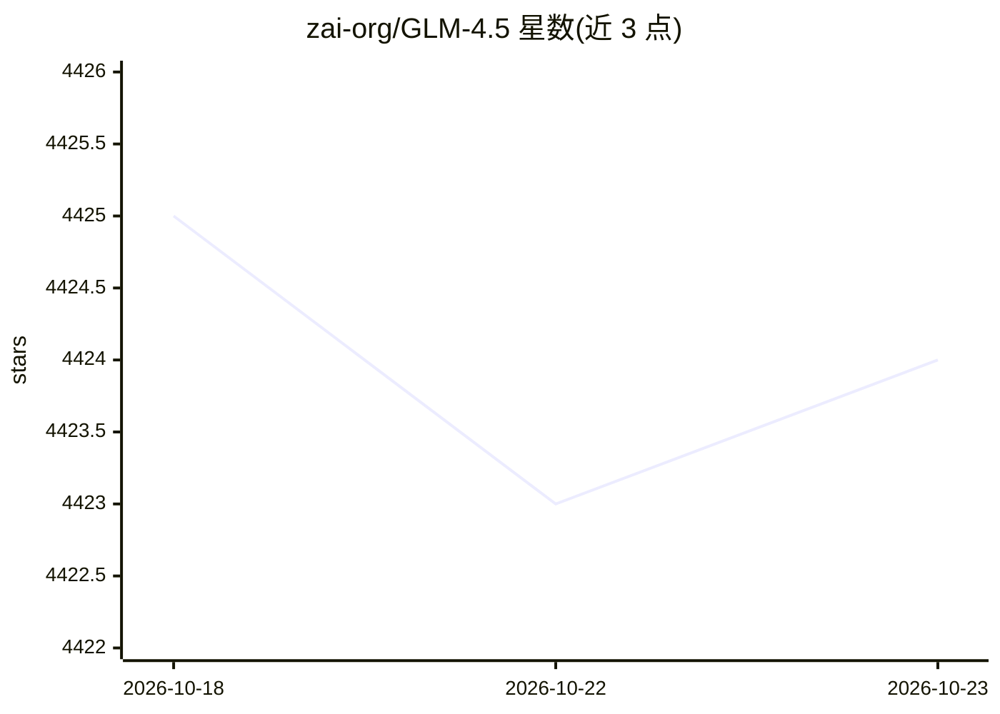

# zai-org/GLM-4.5

⭐ 4,424 · Python · Apache-2.0 · 推送 2026-02-01 · [GitHub](https://github.com/zai-org/GLM-4.5) · [官网](https://z.ai/blog/glm-4.5) · 组织维护 · 中文 README

**智谱开源的 Agentic/推理/编码基础模型（GLM-4.5/4.6/4.7 系列）**

zai-org（智谱）发布的大模型权重仓库，收录 GLM-4.7、GLM-4.6 与 GLM-4.5 系列。GLM-4.5 为 355B-A32B 与 106B-A12B 的 MoE 混合推理模型，MIT 许可，支持思考/非思考双模式；GLM-4.6 将上下文扩展至 200K；GLM-4.7 提供 Interleaved/Preserved/Turn-level Thinking 与 30B-A3B 的 Flash 版。通过 Hugging Face 与 ModelScope 下载权重，模型代码已合入 transformers/vLLM/SGLang，README 给出多卡 H100/Ascend/AMD 配置与推理启动命令。

## 筛选速览

| 维度 | 判定 | 备注 |
|---|---|---|
| AI 角色 | `ai-native` | 本体是模型或模型工具 |
| 许可风险 | `permissive` | Apache-2.0 |
| 部署形态 | `None` |  |
| 模型依赖 | local-ok | 支持本地模型 |
| 硬件要求 | — | 无带数字的原话,不猜 |
| 安装摩擦 | `low` | 无编译、无系统依赖或容器化 |
| 成熟度 | — | 结构信号不足 |

## 能力要点

- GLM-4.5/4.5-Air 权重以 MIT 许可开源，支持商用与二次开发
- 混合推理双模式（thinking / non-thinking），GLM-4.7 增加跨轮保留思考
- 模型代码已合入 transformers、vLLM、SGLang 实现
- 提供 BF16/FP8 版本及 H100 多卡、Ascend NPU、AMD GPU 部署指南

## 适用场景

- 搭建本地推理服务（vLLM/SGLang）用于编码与 Agent 任务
- 在 Claude Code/Cline 等 Agent 框架中接入 GLM 模型
- 基于开源权重做微调（Llama Factory/Swift）与二次开发

## 场景标签

 · 领域:大模型/权重发布

## 证据(README 行号)

> L55: The **GLM-4.5** series models are foundation models designed for intelligent agents. GLM-4.5 has **355** billion to
> L63: We have open-sourced the base models, hybrid reasoning models, and FP8 versions of the hybrid reasoning models for 

## 星数曲线

2026-10-18 4,425 → 2026-10-23 4,424（-1）

---
*卡片 v1 · prompt 1.4 · 生成 2026-10-20 · 置信度 high · 依据 README sha `410db575e7a2` · [字段定义](../../DATASET.md)*
